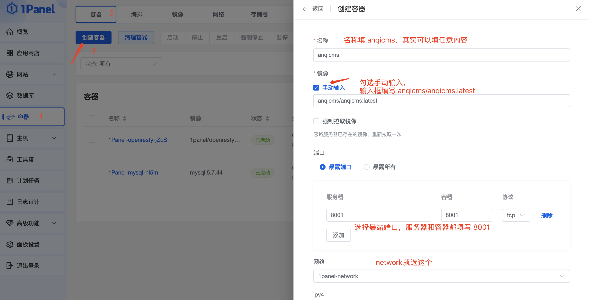
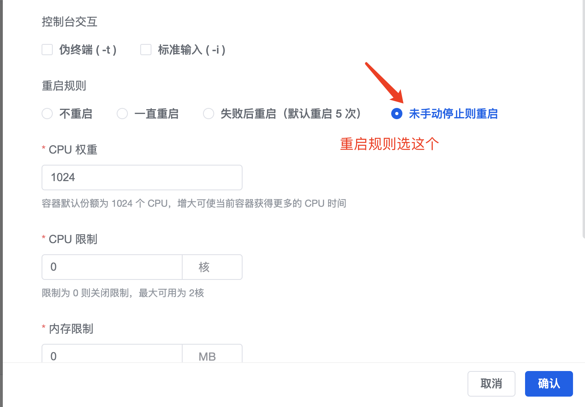
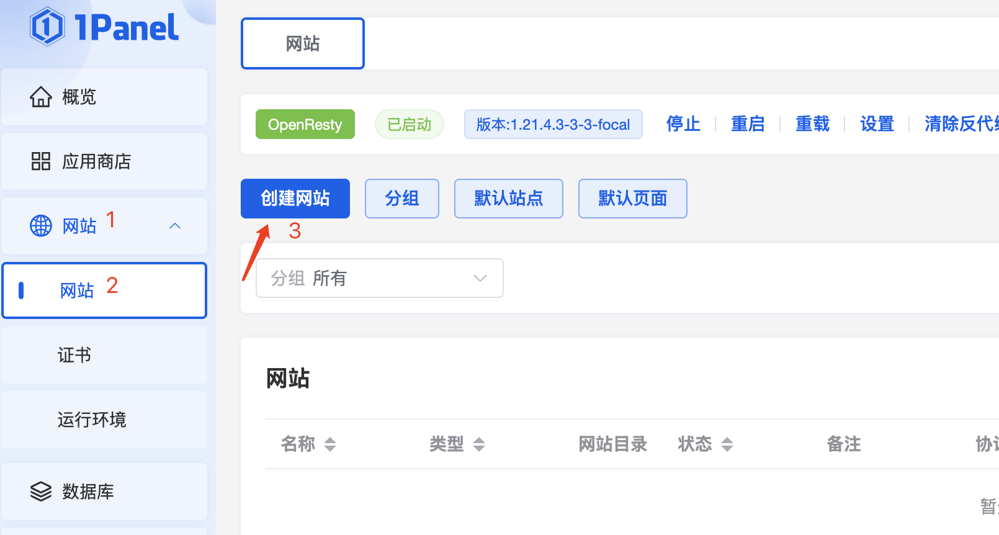
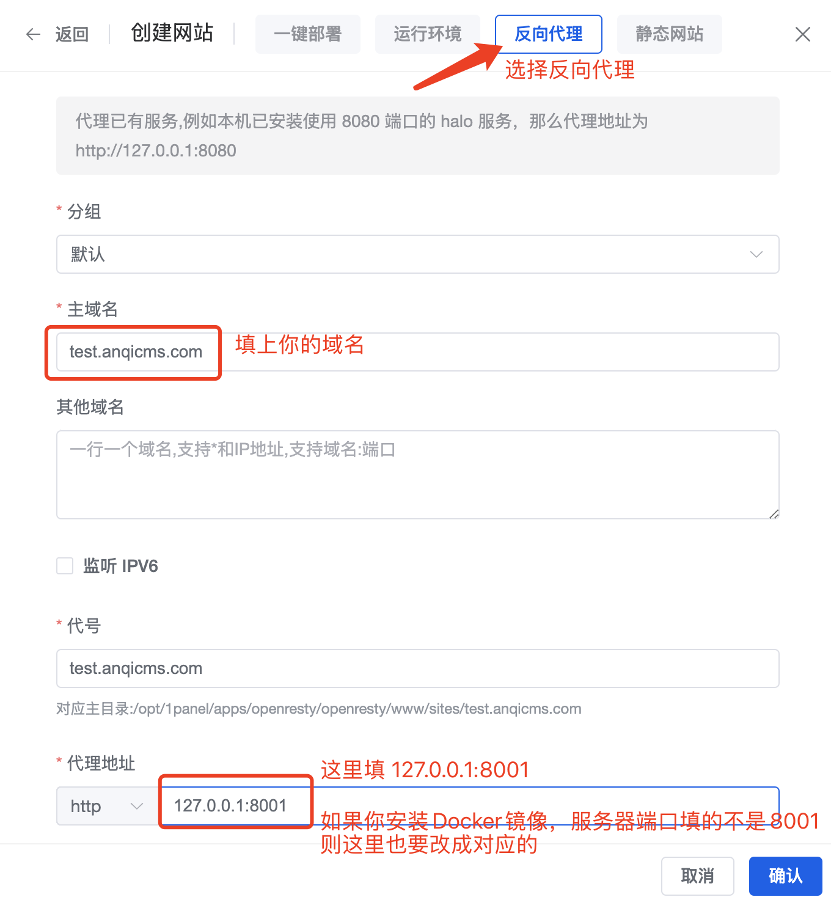

# 使用1Panel的Docker安装AICMS教程

### 1Panel 的安装

1Panel 的安装下载地址： https://1panel.cn/

请根据 1Panel 官网的安装指引进行安装。下面默认你已经安装好了1Panel。

需要的其它配套软件： OpenResty、MySQL，请在 1Panel 的应用商店中安装。

### 用Docker安装AICMS应用

点击左侧菜单中的容器，选择容器Tab，并点击创建容器按钮。

在弹出的界面中，填写名称，填 AICMS；
镜像勾选手动输入，并在输入框中输入 `AICMS/AICMS:latest`；
端口选择暴露端口，服务器和容器分别都填写 8001，如果你需要安装多个容器，则服务器端口填写不同的端口，例如 8002、8003 等，但容器端口依然只填8001。

继续往下拉，到重启规则那里，选择失败后重启或未手动停止则重启都可以。

最后点击确认完成容器的创建。

### 设置反向代理站点

创建容器完毕后，点击左侧菜单中的网站，选择网站，并点击创建网站按钮。

在弹出的界面中，选择【反向代理】
主域名则填写你的域名，例如：test.aicms.com
代理地址填写 `127.0.0.1:8001`。如果你安装多个 AICMS的容器，并设置了不同端口，则这里你需要根据实际填写不同的端口。

最后点击确认完成站点的创建。

### 开始使用网站

在浏览器中输入你上面设置的域名，如：http://test.aicms.com/，进行网站的初始化安装。

安装完成后便可正常使用了。

后台访问地址：你的域名/system/

如你的网站是 http://test.aicms.com/，那么后台的访问路径是：http://test.aicms.com/system/
