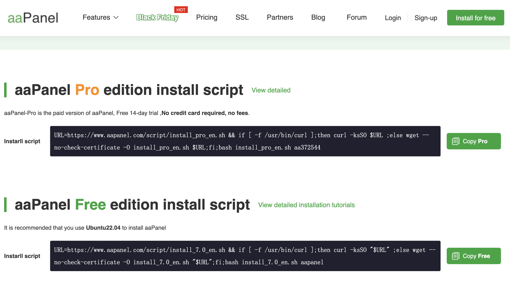
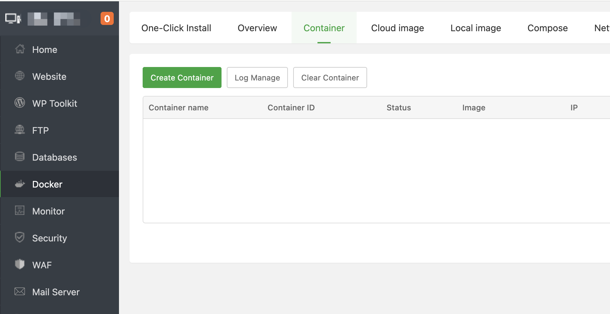
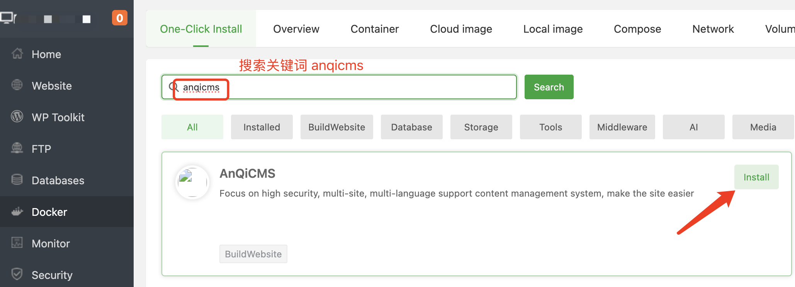
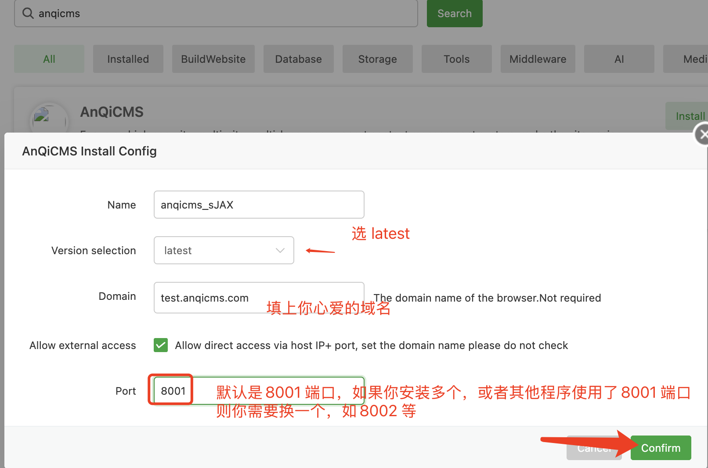
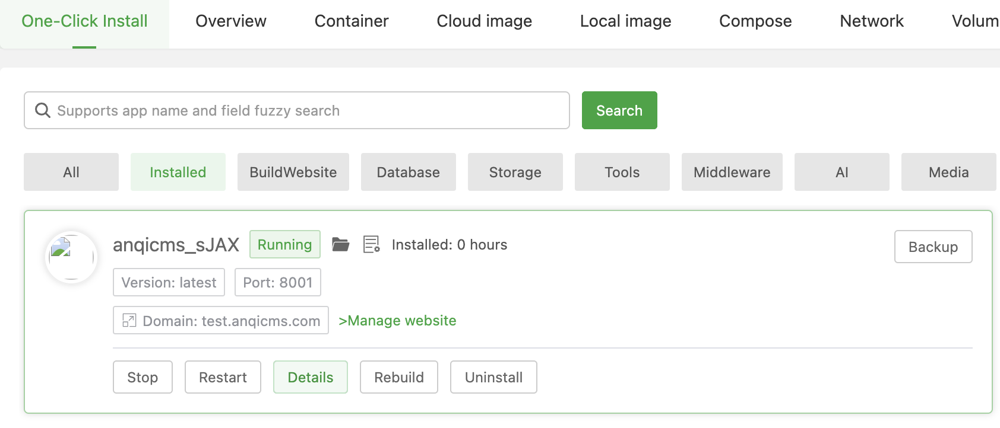
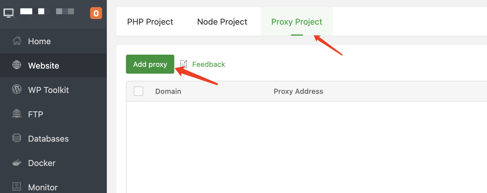
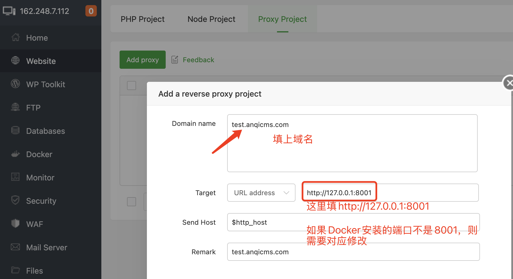
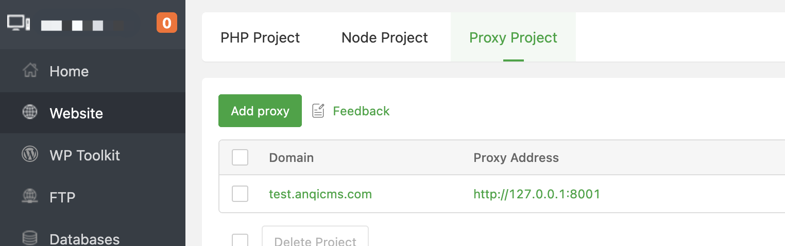

# One-Click Deployment of AICMS with aaPanel  

### Installing aaPanel (BT International Version)  

This Docker-based tutorial for installing AICMS is demonstrated using aaPanel (BT International Version).  

If aaPanel is not installed on your server, follow the steps below to install it. If it's already installed, you can skip this section.  

**Download link for aaPanel:** [https://www.aaPanel.com/new/download.html](https://www.aaPanel.com/new/download.html)  

Visit the download page, copy the appropriate installation command based on your requirements, log in to your server, paste the command, and execute the installation.  

  

Besides command-line installation, you can also choose online installation via aaPanel. If you encounter any issues during the installation process, you can find customer support information on the download page to request assistance.  

### Installing AICMS  

If you have any questions about using Docker with aaPanel, visit the [aaPanel forum](https://www.aapanel.com/forum) for help.  

  

Once Docker is installed, search for **AICMS** in the **App Store**.  

  

From the search results, click the **Install** button to enter the installation interface.  

  

In the installation configuration, fill in the domain name in the **Domain** field and set the port to **8001**, then click **Confirm** to start the installation.  

After clicking confirm, the installation won't complete instantly. Please wait patiently for 1–5 minutes until it finishes.  

If an error occurs, follow the error message instructions to resolve the issue. Then click the **Restart** button to retry.  

Once the Docker installation is configured, the result should look like the image below:  

  

If the installation fails, you may need to manually configure a reverse proxy. Follow the instructions below to handle this:  

  

  

  

### Getting Started with the Website  

By default, the website is pre-installed, and default credentials are provided.  

- **Default Username:** `admin`  
- **Default Password:** `123456`  
- **Admin Access URL:** `your-domain/system/`  

For example, if your website is `http://test.aicms.com/`, the admin access URL is `http://test.aicms.com/system/`.  

Open your browser and visit the domain you entered earlier with `/system/`, e.g., `http://test.aicms.com/system/`. Once on the website management interface, update the default username and password, and you’re ready to start using it.