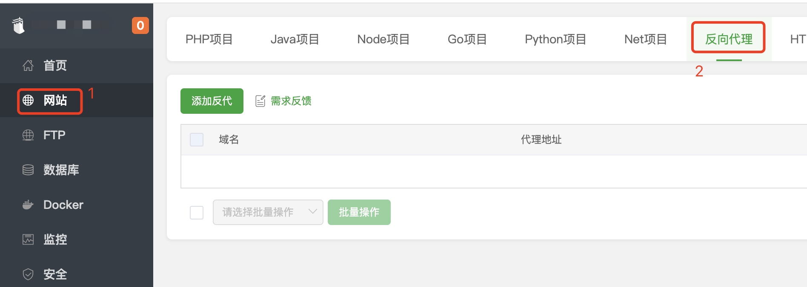
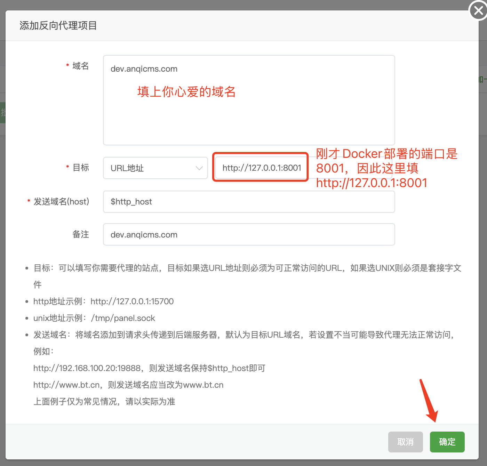
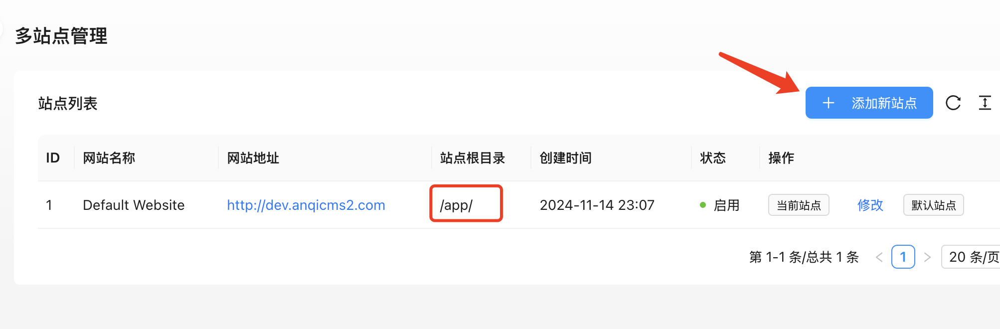
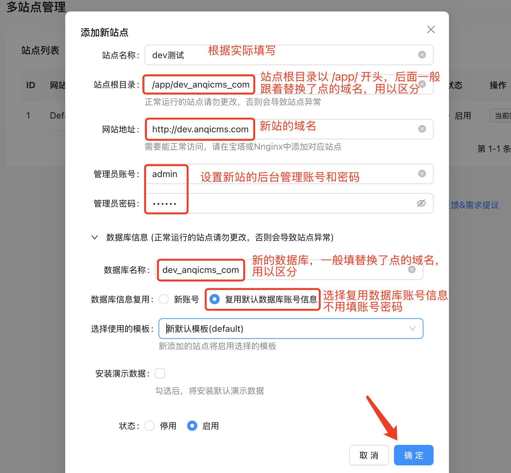
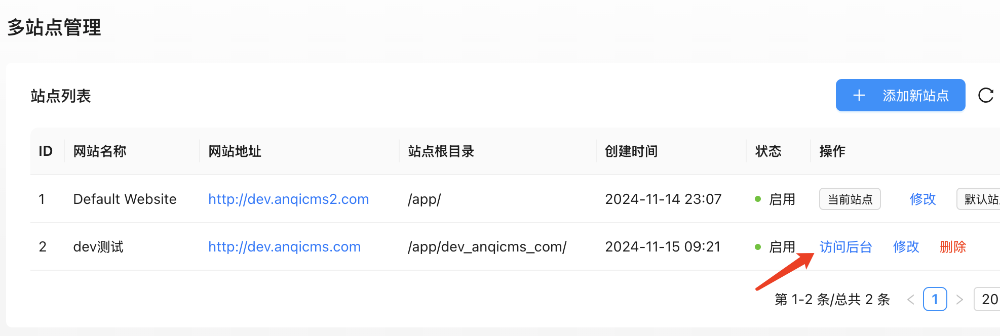

# 通过反向代理添加AICMS多站点教程

前一篇的教程展示了使用宝塔的Docker安装AICMS教程。

阅读地址：

下面介绍使用宝塔的反向代理站点功能，添加AICMS多站点的教程。

## 在宝塔面板添加反向代理站点

在宝塔面板中左侧菜单，选择【网站】，在网站界面上，选择【反向代理】，并点击【添加反代】来创建反向代理站点。

在添加反向代理站点的界面上，域名一栏填上新站的域名，目标一栏中，添加Docker部署的AICMS站点的时候填写的端口，默认是8001。因此这里填写 http://127.0.0.1:8001

最后点确定完成反向代理站点的创建。

## 在AICMS后台添加新站点

上面添加了反向代理站点，接着我们来到AICMS后台，在左侧菜单中找到多站点管理功能，并点击【添加新站点】。

注意由于AICMS是在Docker里部署的，因此默认站点根目录也是Docker里的 /app/ 目录。

在添加新站点的界面上，填写：

- **站点名称** 根据实际填写
- **站点根目录** 以`/app/`开头，加上替换了点为下划线的域名，如 `/app/dev_aicms.com`，用于独立存储新站点的缓存等数据，不要和其他站点目录名重复
- **网站地址** 你的新网站地址，如 `http://dev.aicms.com`
- **管理员账号密码** 设置新站点的后台管理账号和密码
- **数据库名称** 新的站点的数据库，一般填替换了点为下划线的域名，用于独立存储新站点的数据，如 `dev_AICMS_com`
- **数据库信息复用** 选择【复用默认数据库账号信息】因为我们是Docker安装的AICMS，永远全部的数据库管理权限，因此这里无需重新填写数据库账号密码。如果你要将数据库安装到别的地方，则可以如实填写。
- **选择使用的模板**

最后点击【确定】按钮，完成站点的创建。

## 使用新的站点

上面已经创建好了站点，并设置了反向代理了，因此至此新的网站便可以直接访问使用了。

你可以通过多站点管理列表的【访问后台】按钮，直达新的网站后台。也可以在浏览器地址栏输入后台地址。

后台地址是：你的域名/system

祝你使用AICMS愉快！