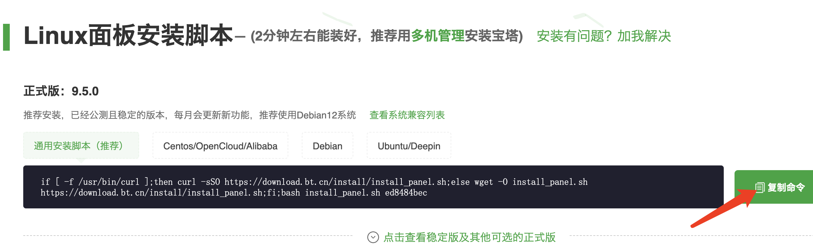
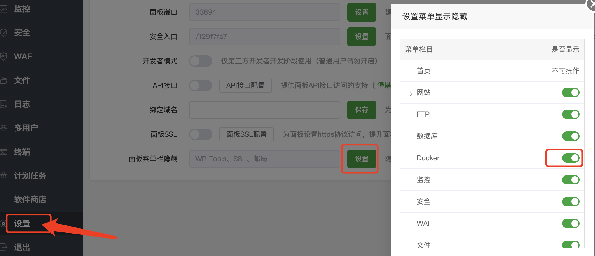
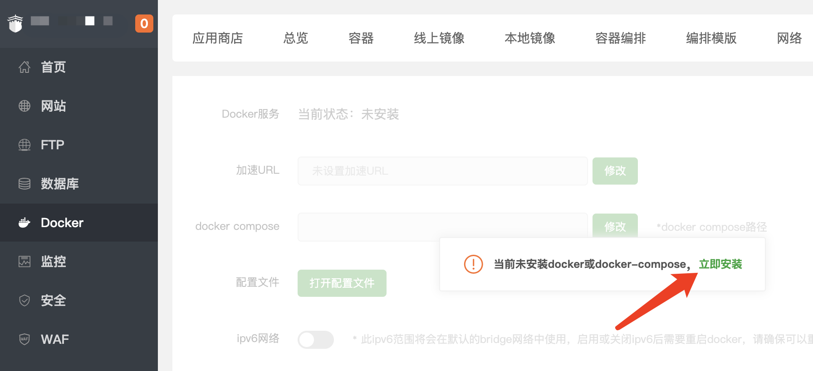
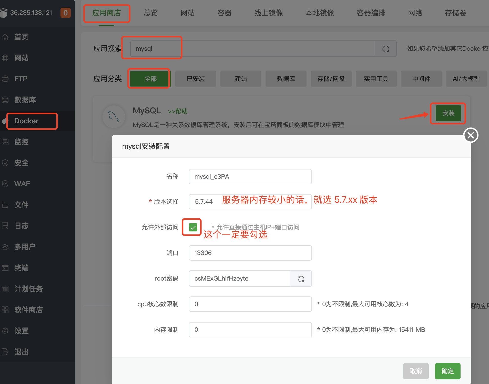
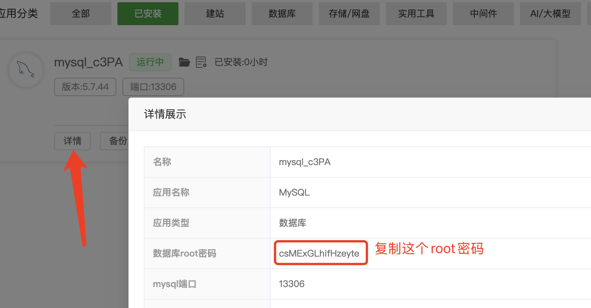
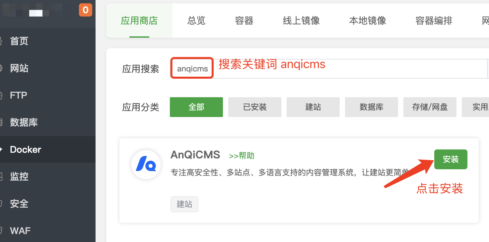
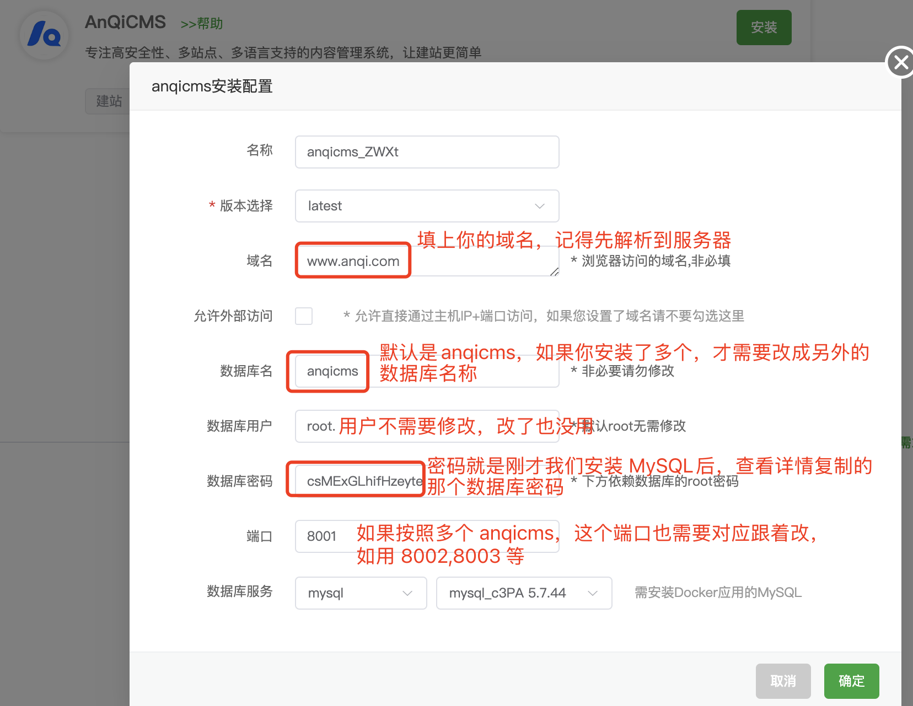
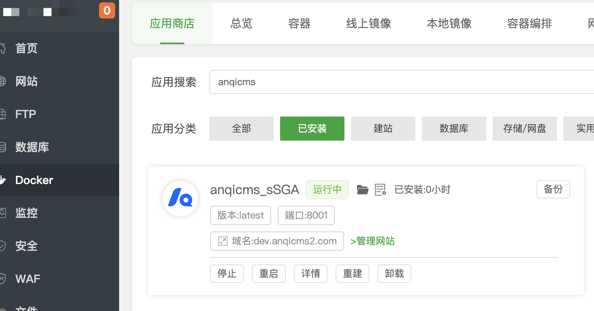

# 使用宝塔的Docker安装AICMS教程

### 宝塔的安装

说明：Docker 部署适用宝塔面板9.2.0以上的版本（2024年9月5日后发布的版本）

下面的Docker安装AICMS教程，是基于宝塔面板9.5.0版本演示的。

如果你的服务器还没安装宝塔，请按照这个步骤安装，如果已经安装的，可以跳过。如果你安装的不是9.2.0版以上的版本，可以尝试先升级到9.5.0或更高版本。

宝塔下载地址：https://www.bt.cn/new/download.html

访问宝塔下载地址，在【Linux面板安装脚本】中选择【通用安装脚本（推荐）】，复制命令，登录服务器粘贴并执行安装。

除了命令安装，你也可以选择使用宝塔的在线安装，如安装中遇到问题，可以在宝塔下载地址上面找到客服，请求客服帮助。

### 用Docker安装AICMS应用

Docker 是一个开源的应用容器引擎（位置：左侧菜单->Docker，如未找到需前往：面板设置->面板菜单隐藏->开启Docker显示）

关于宝塔面板的Docker使用，如果有疑问，可以访问 https://www.bt.cn/bbs/thread-137717-1-1.html 寻求帮助。

初次进入的时候，会要求先安装Docker，点击【立即安装】进行安装。

安装完了之后，需要进行依赖安装。

在安装AICMS之前，需要先安装 Docker 版的MySQL，在 Docker 的应用商店搜索 mysql，并点击安装。

如果服务器内存低于2G，请选择 5.6版本，默认就选择5.7版本。勾选允许外部访问（默认是勾选的）。

安装完成后，点击【详情】链接，查看mysql详情，复制root密码，等会安装AICMS的时候，需要用到这个密码。

在应用商店搜索 AICMS，

搜索到的结果中，点击【安装】按钮，进入安装界面。
在安装界面上，填写上你的信息：
  - 网站域名 （如：www.aicms.com）
  - 数据库名称 （默认是AICMS，如果你需要安装多个AICMS，则需要修改成其他的数据库名称）
  - 数据库密码 （数据库密码是刚才我们安装MySQL后，查看详情复制的那个 root 密码）
  - 端口（默认是8001，如果你安装了多个AICMS，则需要修改成其他的端口，如8002，8003等）

点击【确定】进行安装。点击确定后，不会马上就安装完成，请耐心等待1-5分钟，等待安装完成。

Docker安装配置完成后如下图：

### 开始使用网站

默认网站已经安装好了，并且设置了默认的账号密码。

默认账号：admin
默认密码：123456

后台访问地址：你的域名/system/

如你的网站是 http://dev.aicms.com/，那么后台的访问路径是：http://dev.aicms.com/system/

在浏览器访问刚才填写的域名+/system/，如：http://dev.aicms.com/system/ 打开网站管理界面，修改默认账号密码，并开始使用。
