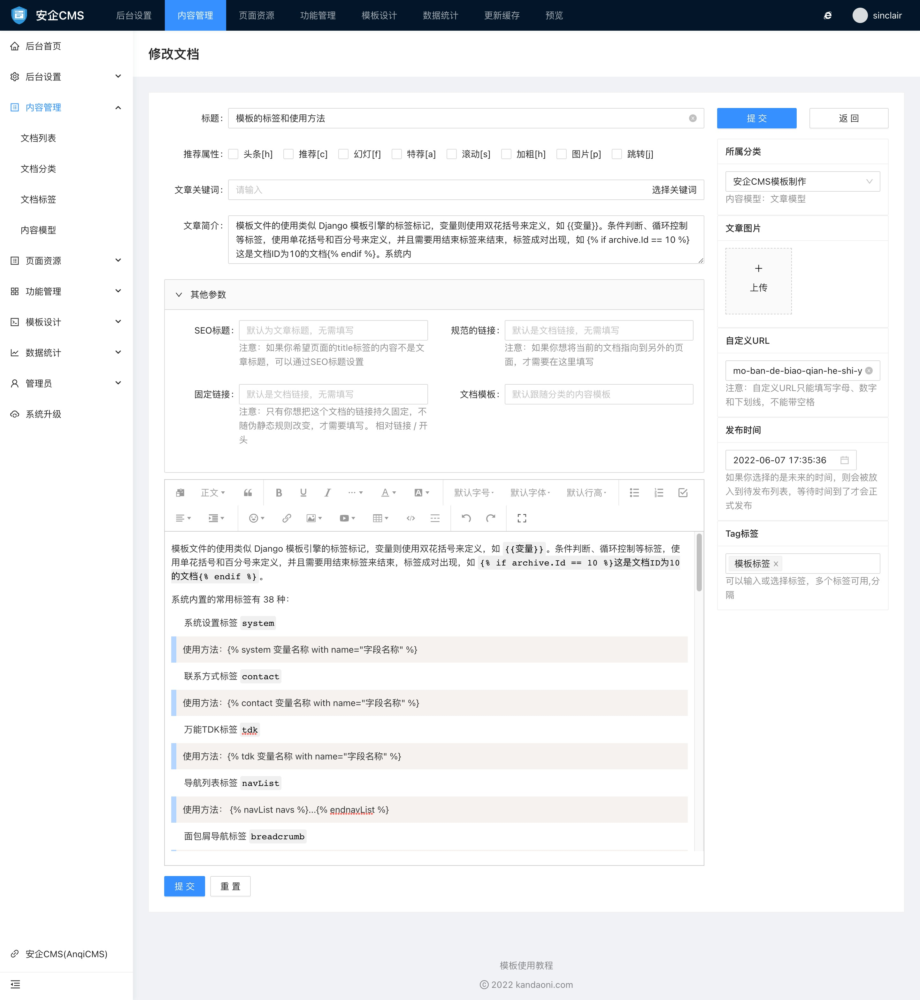
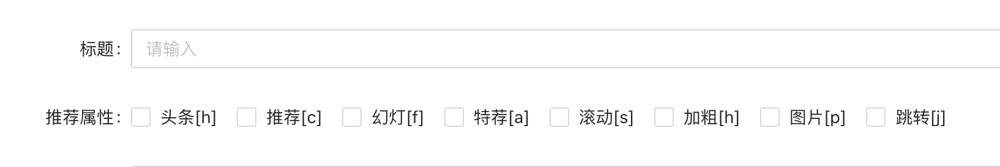
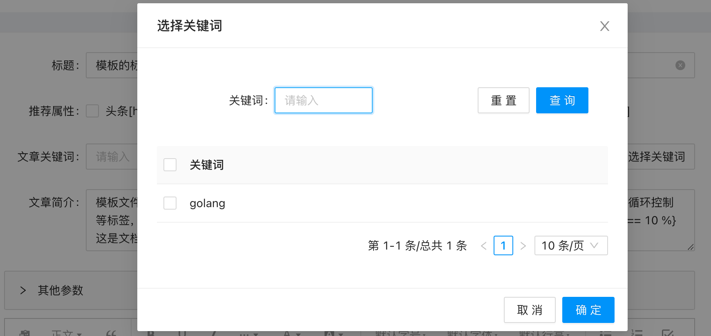
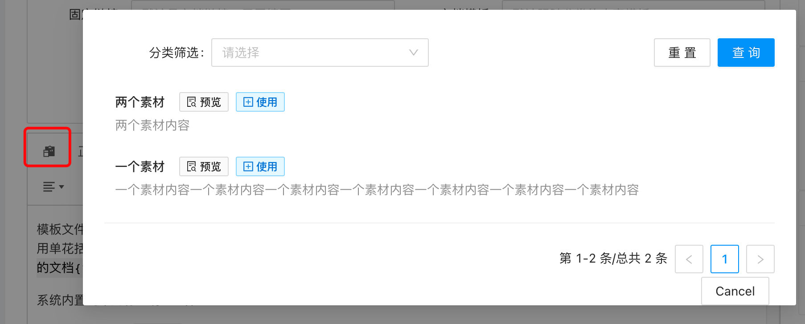
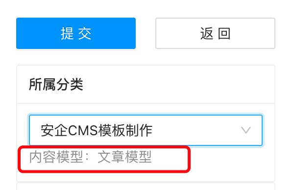
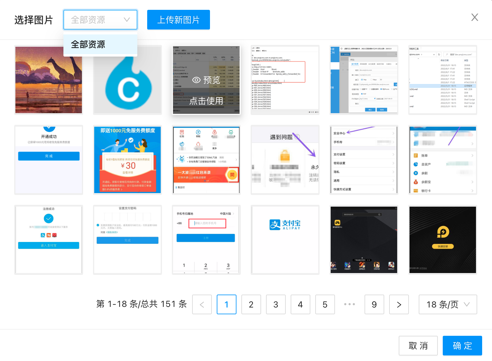
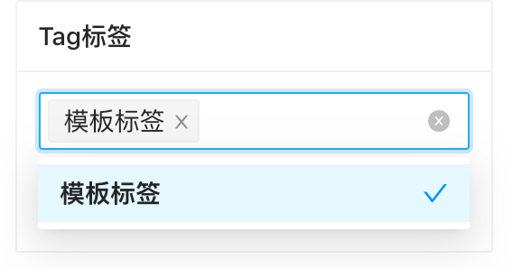

# 添加文档使用说明

添加文档功能提供了强大的文档添加的操作功能。通过添加文档界面，我们可以给文档添加各种类型的属性，如文档标题、推荐属性、文档分类、缩略图、tag标签等内容。

添加文档的界面上默认具有的功能有：

- 文档标题
文档标题为必填项，文档标题用于文档展示给用户的h1标题。

- 推荐属性
文档的推荐属性可以指定8种属性，可以单选、多选或不选，选择后，前台模板可以通过指定的属性字母，`flag="h"`来调用指定的推荐内容。注意的是，前台调用的时候，每个列表只能使用一个属性来调用。

可用的标签分别有：`头条[h]`、`推荐[c]`、`幻灯[f]`、`特荐[a]`、`滚动[s]`、`加粗[h]`、`图片[p]`、`跳转[j]`。

- 文档关键词
文档关键词可以手动输入填写，也可以通过选择关键词按钮来选择关键词库里的关键词。多个关键词之间请使用英文的 `,` 来区分，因为这样更符合搜索引擎收录的习惯。

- 文档简介
文档简介一般是一篇文章的简要介绍。文档简介建议不超过150字为宜。当你没有填写文档简介的时候，系统会自动提取文档内容里的前150字作为文档简介。

- 文档内容
文档内容的编辑器，提供了丰富的内容编辑方式。常用的编辑按钮有：设置标题/正文、引用、加粗、下划线、斜体、删除线、行内代码、上标、下标、清除格式、字体颜色，背景颜色、字号、字体、行高、有序列表、无序列表、待办事项、对齐方式、缩进方式、表情符号、链接、图片插入、视频插入、表格插入、代码插入、分割线插入、撤销重做等功能。除了常用了编辑按钮外，还支持使用段落素材库素材、已上传的图片资源等。

- 所属分类
每一篇文档，都必须选择一个分类。所有的文档，都是要根据分类来决定这篇文档属于什么类型的模型。
因此选择所属分类后，就可以展示内容模型的模型字段，来提供输入。例如示例中，我们选择了AICMS模板制作这个分类，这个分类属于文章模型，这个时候，我们就可以在其他参数中，填写文档模型的其他字段的内容了。

- 文档图片
文档图片这里是指文档的缩略图。文档缩略图可以通过选择图片库里的图片，也可以上传新的图片。如果你没有上传图片，但是文档内容中包含有图片，则系统会自动提取文档内容的第一张图片作为文档缩略图图片。

- 自定义URL
自定义URL是为了给文档启用命名模式的伪静态规则调用的。也只有在网站伪静态规则使用了`{filename}`这个字段的命名模式下，自定义URL才生效。
默认自定义URL会根据你输入的文档标题，自动根据拼音生成。如果你对自动生成的不满意，可以通过手动输入来设置自定义内容。需要注意的是，自定义URL必须保证全站唯一，如果不是唯一的，则系统会在后面添加随机数字让它保证唯一。

- 发布时间
发布时间默认是自动生成的，默认会是发布的时候的当前时间。如果你需要你的文档是未来某个时间自动发布的定时发布文档，则可以将发布时间设置为未来时间，这样文档就会在到达指定发布时间后，才正式发布。发布时间的格式是：`2006-01-02 15:04:05`

- Tag标签
你可以给文档添加多个标签，标签有点类似于话题，可以将同一类的文档通过除了分类的方式关联在一起外的另一种关联方式。
你可以选择已存在的标签，也可以通过输入来新增新的标签。当你输入一个新标签文字后，按回车键即可将它转换成标签了。

- 其他参数
对于一些不太常用的参数字段，我们放到了其他参数一个折叠筐内，你可以通过展开折叠筐来为文档填写更多的资料。

  - SEO标题
  SEO标题是用于展示给搜索引擎看到标题内容。注意：如果你希望页面的title标签的内容不是文章标题，可以通过SEO标题设置

  - 规范的链接
  如果你想将当前的文档指向到另外的页面，才需要在这里填写。规范的链接需要你在模板中使用canonical标签来调用。该标签在做外贸网站可能会用到。链接请使用 http 或 https 开头的完整链接，如： `https://www.kandaoni.com/article/98`

  - 固定链接
只有你想把这个文档的链接持久固定，不随伪静态规则改变，才需要填写。 相对链接 / 开头。如：`/download`

  - 文档模板
  当你需要给单篇文档指定独立的展示模板，则可以在这里填写上你需要使用的模板名称。注意，你一定要保证该模板是存在于你的模板设计包里的，否则会导致这篇文档打不开。如你创建了一个 `download.html` 模板，用于展示这篇文档，则在这篇文档的文档模板的输入框里，填写上 `download.html`。

  - 更多模型自定义字段
当你使用的内容模型自定义了更多模型自有的字段，则也会在其他参数的折叠筐这里一一展示，你可以通过根据具体需要填写内容。
如果你定义的字段有默认值，并去你只想按默认值来显示，则这里填写只需要留空即可，在前端调用的时候，系统会自动将默认值赋值给指定的字段的。