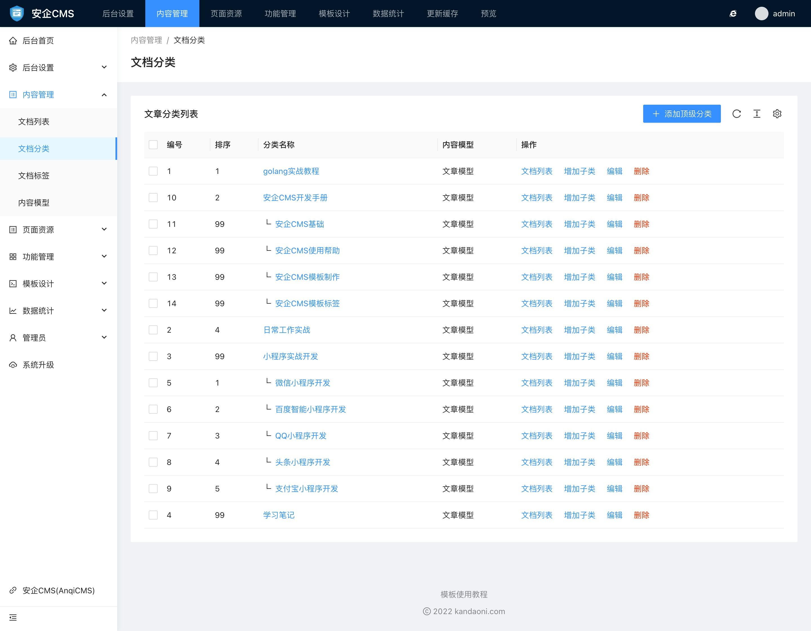
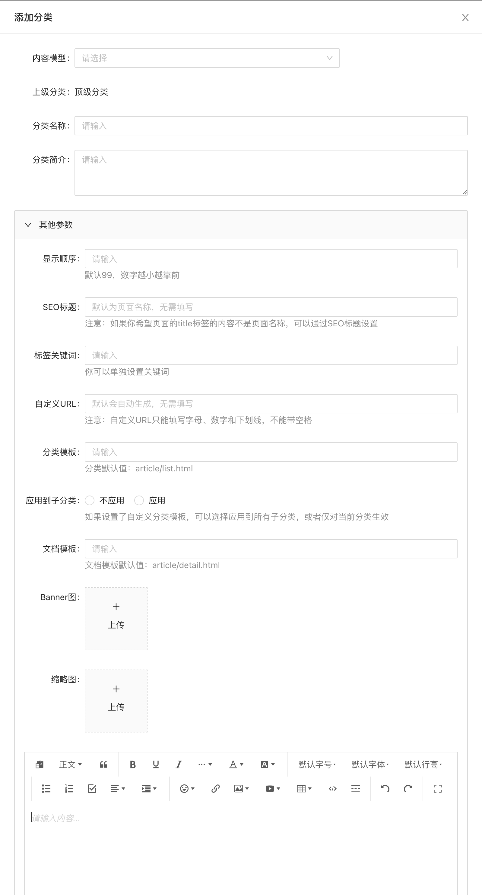

# 文档分类使用帮助

文档分类管理可以管理不同内容模型的分类。每个分类只属于一个内容模型。

通过分类管理，你可以快速的查看当前分类的文档列表，给当前分类添加下级分类，编辑修改分类内容等操作。

当一个分类创建后，它的内容模型就固定了，它就不能再改变内容模型。

文档分类添加和编辑的表单中，你可以输入的内容有：

- 文档模型
文档模型一旦选择了，就不能再改变了。文档模型只有在添加顶级分类的时候可以选择。

- 上级分类
只有增加子分类的时候，可以选择上级分类。请选择相同的模型作为上级分类。

- 分类名称
分类名称则为分类的前台显示名称。

- 分类简介
分类简介为分类的介绍，同时也是tdk标签中的description标签的调用内容。

- 其他参数
其他参数里包含了一些不太常用，不是必须要设置的内容字段。你可以根据实际需要，来设置这些字段内容。

  - 显示顺序
  显示顺序可以决定这个分类的排序，数字越小，显示越靠前。默认创建的时候，默认值为99。

  - SEO标题
  SEO标题是用于展示给搜索引擎看到标题内容。注意：如果你希望页面的title标签的内容不是分类名称，可以通过SEO标题设置

  - 关键词
  分类关键词可以手动输入填写。多个关键词之间请使用英文的 `,` 来区分，因为这样更符合搜索引擎收录的习惯。你也可以不设置。

  - 自定义URL
  自定义URL是为了给启用命名模式的伪静态规则调用的。也只有在网站伪静态规则使用了`{filename}`、`{catname}`这个字段的命名模式下，自定义URL才生效。
默认自定义URL会根据你输入的分类名称，自动根据拼音生成。如果你对自动生成的不满意，可以通过手动输入来设置自定义内容。需要注意的是，自定义URL必须保证唯一，如果不是唯一的，则系统会在后面添加随机数字让它保证唯一。

  - 分类模板
  你可以给分类设置自定义的模板，默认的模板为`{分类模型}/list.html`，你可以根据实际需要设置为其他名称的模板名称。注意，你一定要保证该模板是存在于你的模板设计包里的，否则会导致这个分类打不开。如你创建了一个 `download.html` 模板，用于展示这个分类，则在这里，填写上 `download.html`。

  - 是否应用到子分类
  默认分类模板是不继承给下级分类的，你可以设置为继承，这样只会，这个分类下所有的子分类，都会使用你设定的自定义模板。

  - 文档模板
  当你需要给这个分类下的所有文档，都使用自定义的模板，则可以在这里填写上你需要使用的模板名称。注意，你一定要保证该模板是存在于你的模板设计包里的，否则会导致这个分类下所有的文档打不开。如你创建了一个 `detail.html` 模板，用于展示这个分类下的文档详情，则在这里，填写上 `detail.html`。

  - Banner图
  有些分类可能需要展示一些banner轮播图片，你可以在这里设置。你可以上传多张图片。注意上传的时候，请使用相同尺寸的图片。

  - 缩略图
  分类的缩略图不是必须的，当你需要在前台页面调用分类缩略图的时候，才需要上传。

  - 分类内容
  分类内容不是必须的，只有当你需要在前台页面调用分类内容的时候，才需要填写。分类内容编辑器功能丰富，支持各种文本操作。