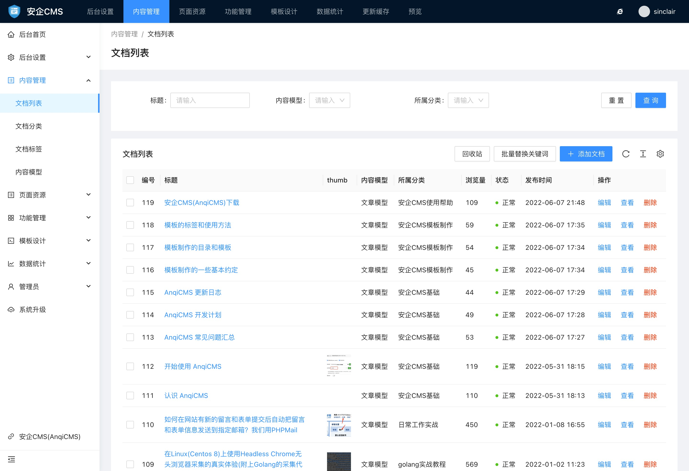
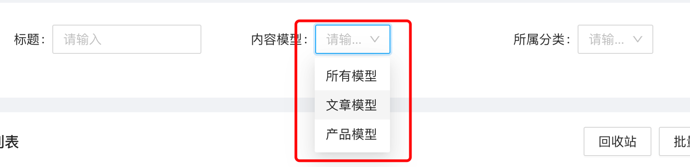
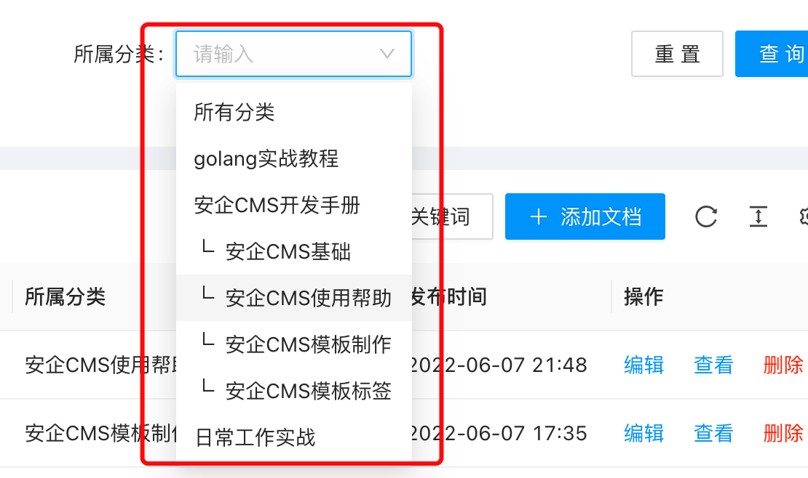
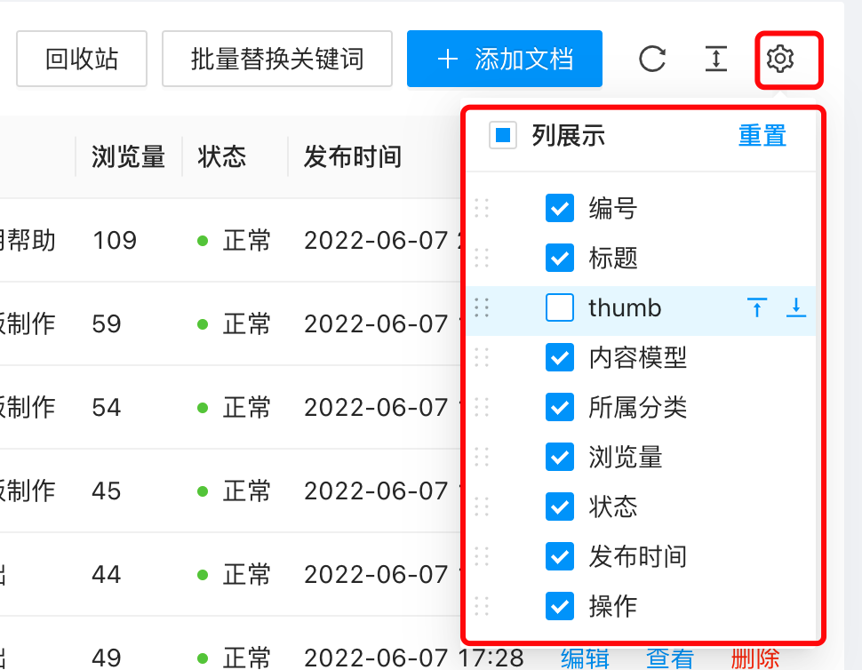
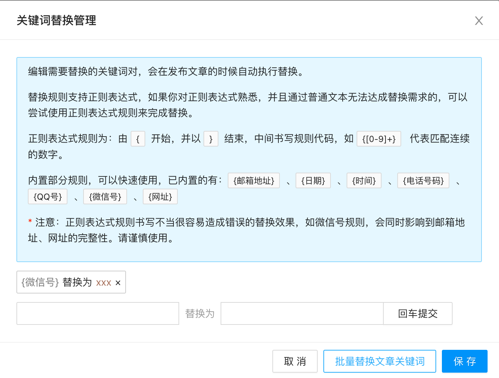
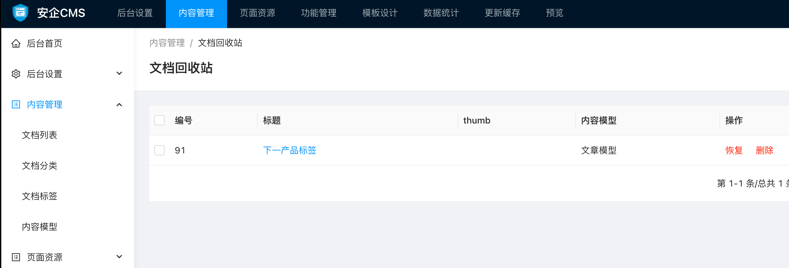

# 文档管理使用说明

文档管理是整站的文档管理中心，可以对文档进行发布、删除、回收站、草稿管理、批量替换关键词等各种操作。

### 文档列表

文档列表展示了所有的文档。并且你可以在文档列表上进行文档的各项操作，如添加新文档、删除、查看，编辑、批量删除、搜索筛选等操作。

文档列表可以通过文档标题、内容模型、所属分类来筛选文档列表展示内容。

- 文档标题筛选
输入关键词后，则只会列出包含你输入的关键词的文档，标题匹配是连续匹配，也就是说例如你输入的是`模板标签`，这个关键词，它只会匹配包含`模板标签`连续的词的文档，不会自动拆分成更小的词来匹配搜索筛选。

- 内容模型筛选
根据选择模型后，只会列出该模型的文档，比如选择了文档模型，则只会列出文档模型的文档，其他模型的文档会被隐藏。

- 所属分类筛选
可以只列出属当前分类，以及当前分类下所有子分类的文档列表。

文档列表上，还可以通过设置，来决定列表显示的列内容。如图：

### 文档关键词替换

文档列表上，还可以对所有的文档进行关键词快速替换功能。

编辑需要替换的关键词对，会在发布文章的时候自动执行替换。

替换规则支持正则表达式，如果你对正则表达式熟悉，并且通过普通文本无法达成替换需求的，可以尝试使用正则表达式规则来完成替换。

正则表达式规则为：由 `{`开始，并以 `}`结束，中间书写规则代码，如 `{[0-9]+}` 代表匹配连续的数字。

内置部分规则，可以快速使用，已内置的有：`{邮箱地址}`、`{日期}`、`{时间}`、`{电话号码}`、`{QQ号}`、`{微信号}`、`{网址}`

* 注意：正则表达式规则书写不当很容易造成错误的替换效果，如微信号规则，会同时影响到邮箱地址、网址的完整性。请谨慎使用。

### 文档回收站

当你通过单项删除，或批量删除后，删除的文档不会被立即物理删除，而是被放置到回收站里面，你可以来到回收站，对回收站里的文档进行再次操作。回收站支持的操作有：恢复文档、删除文档。

恢复文档可以将文档恢复到正常的文档列表中。

删除文档则会将文档永久删除，再也恢复不回来了。

注意：回收站默认只保留7天，7天未对回收站进行处理的话，文档会系统自动回收删除处理。
