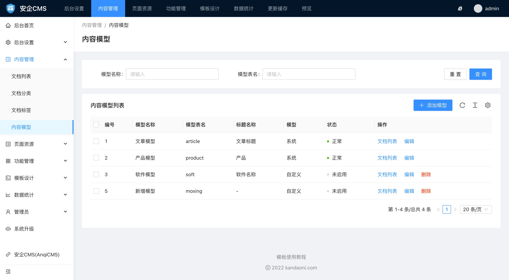
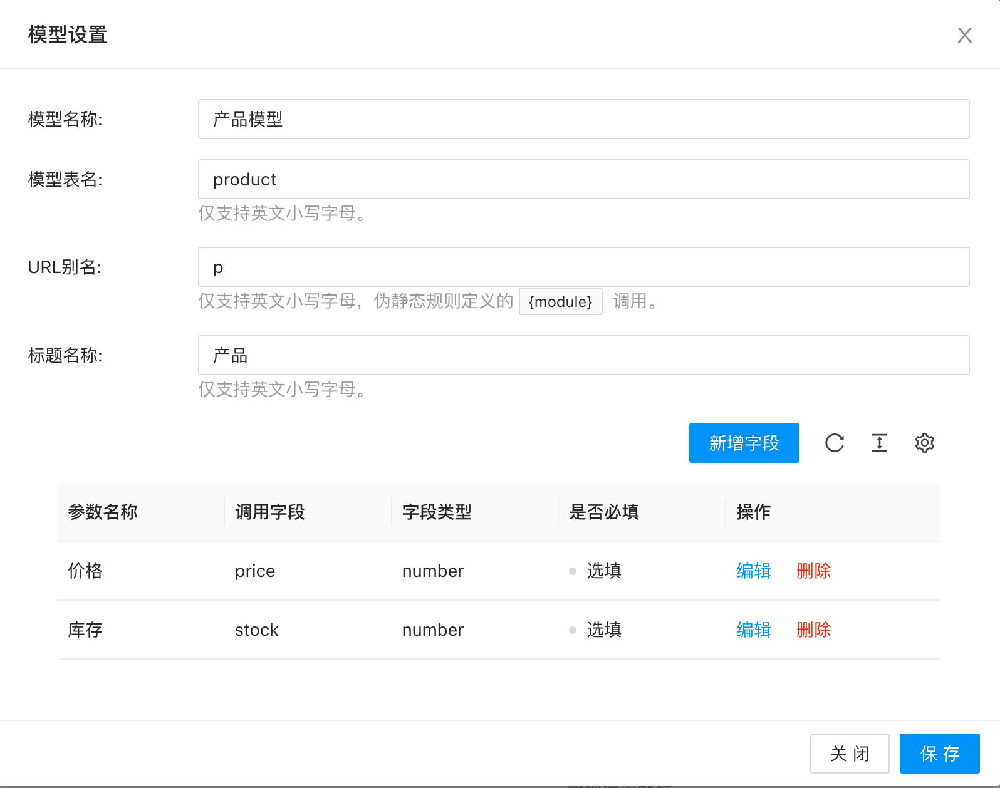
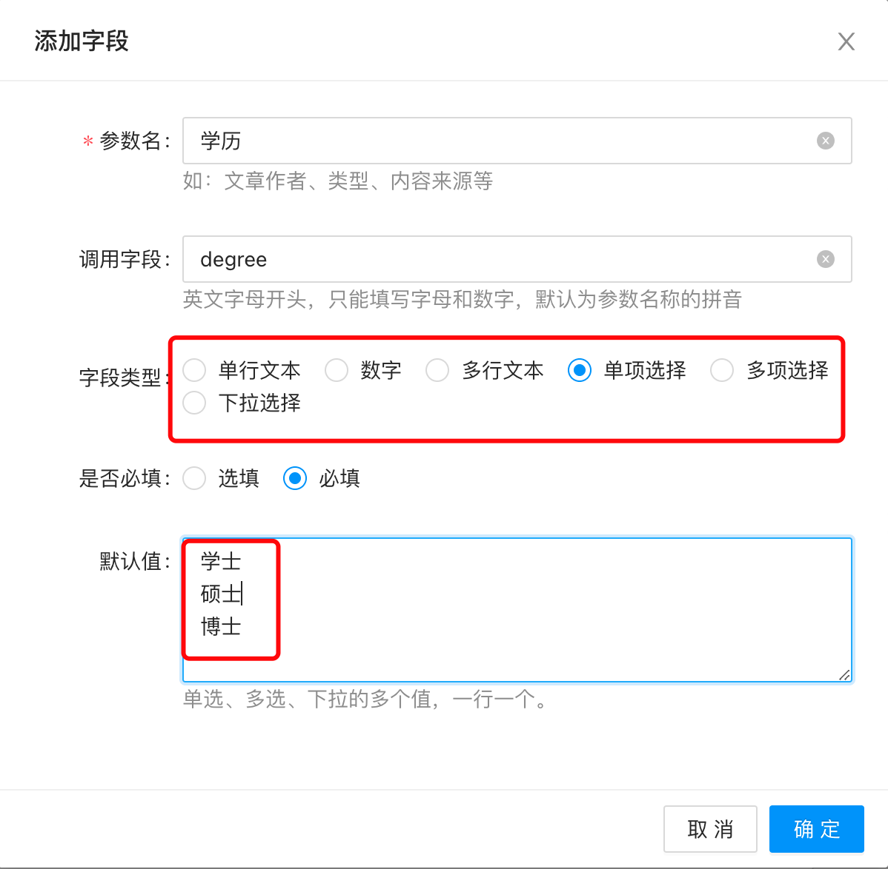

# 内容模型使用帮助

内容模型决定了整站的文档功能。

系统默认内置了 `文章模型` 和 `产品模型` 这2个模型。

系统内置的内容模型可以修改，但不能删除。新增的自定义模型可以修改和删除。

需要注意的是，当你想删除模型的时候，一定要深思熟虑，删除模型后，该模型下的所有文档和分类也会一并被删除。

内容模型可以修改的内容字段有：

- 模型名称
模型名称会作为识别模型的中文名称，也会显示在面包屑导航中作为模型级别的显示名字。

- 模型表名
模型表名为模型自定义字段内容存放在数据库中的表，表名必须是**英文小写字母**，如果填写其他内容，有可能导致内容不能正确显示。

- URL别名
仅支持英文小写字母，伪静态规则定义的 {module}调用。会显示在url上。请使用**英文小写字母**

- 标题名称
用于显示在发布文档的时候，文档标题提示位置，比如你创建了一个产品模型，可以将标题名称填写为`产品名称`，则在发布文档的时候，就会显示产品名称为标题提示。

- 内容模型自定义字段
在这里你可以给内容模型设置只有该模型才有的字段。

添加的字段表单可以设置的内容有：

  - 参数名
  参数名为提供显示的中文名，如文章作者、文章来源等文字。

  - 调用字段
  调用字段是会被写入到数据库表里的字段名称，请使用英文字母作为调用字段。如`author`

  - 字段类型
  这里支持设置的字段类型有：
    - 单行文本
    可以输入一行文本，不超过250字
    - 数字
    只能输入数字
    - 多行文本
    可以输入多行文本内容
    - 单项选择
    可以设置多个选择项，但只允许选择其中一项。选择项通过下方的默认值来设置。
    - 多项选择
    可以设置多个选择项，也可以选择多个选项。选择项通过下方的默认值来设置。
    - 下拉选择
    可以设置多个选择项，但只允许选择其中一项。选择项通过下方的默认值来设置。

  - 是否必填
  可以指定这个字段是否是必须填写的。如果是必须填写的，则会校验提交的数据中是否包含这个字段。

  - 默认值
  当这个字段需要默认为某个值的时候，可以在这里填写上默认值。但要注意，单项选择、多项选择、下拉选择三种模式的时候，默认值则是它们的选项值。单选、多选、下拉的多个值，请在默认值这里输入一行一个来表示，系统会自动按一行为一个选项来解析。