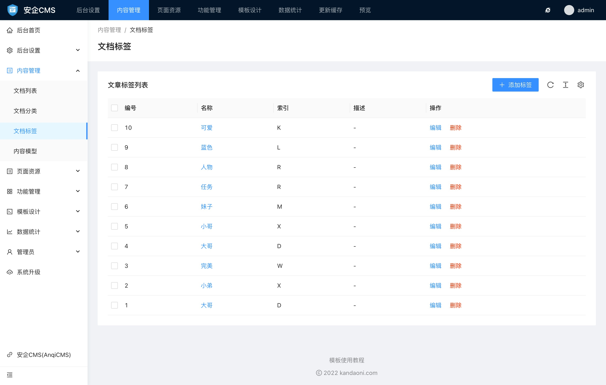
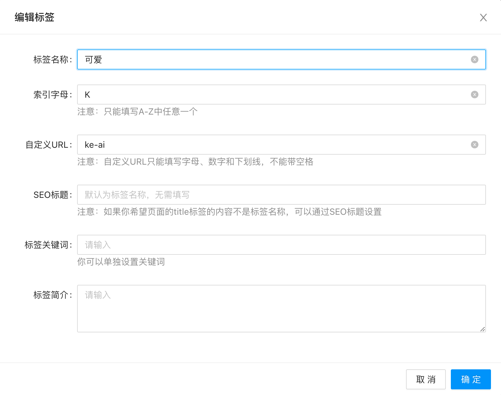

# 文档标签使用帮助

文档标签管理可以查看和管理所有的文档标签。文档标签不分分类和模型，同一个标签可以同时给不同的内容模型的文档标记。

文档标签比较简单，它有标签名称、索引字母、描述内容等。

你可以在标签管理中进行新增、编辑、删除等操作。

新增文档标签中，可以填写和添加的字段有：

- 标签名称
标签的显示名称。

- 索引字母
索引字母只会包含A-Z中的一个。不能填写其他内容。

- 自定义URL
自定义URL是为了给启用命名模式的伪静态规则调用的。也只有在网站伪静态规则使用了`{filename}`这个字段的命名模式下，自定义URL才生效。
默认自定义URL会根据你输入的标签名称，自动根据拼音生成。如果你对自动生成的不满意，可以通过手动输入来设置自定义内容。需要注意的是，自定义URL必须保证唯一，如果不是唯一的，则系统会在后面添加随机数字让它保证唯一。
注意：自定义URL只能填写字母、数字和下划线，不能带空格

- SEO标题
SEO标题是用于展示给搜索引擎看到标题内容。注意：如果你希望页面的title标签的内容不是标签名称，可以通过SEO标题设置

- 标签关键词
标签关键词可以手动输入填写。多个关键词之间请使用英文的 `,` 来区分，因为这样更符合搜索引擎收录的习惯。你也可以不设置。

- 标签简介
标签简介为标签的介绍，同时也是tdk标签中的description标签的调用内容。