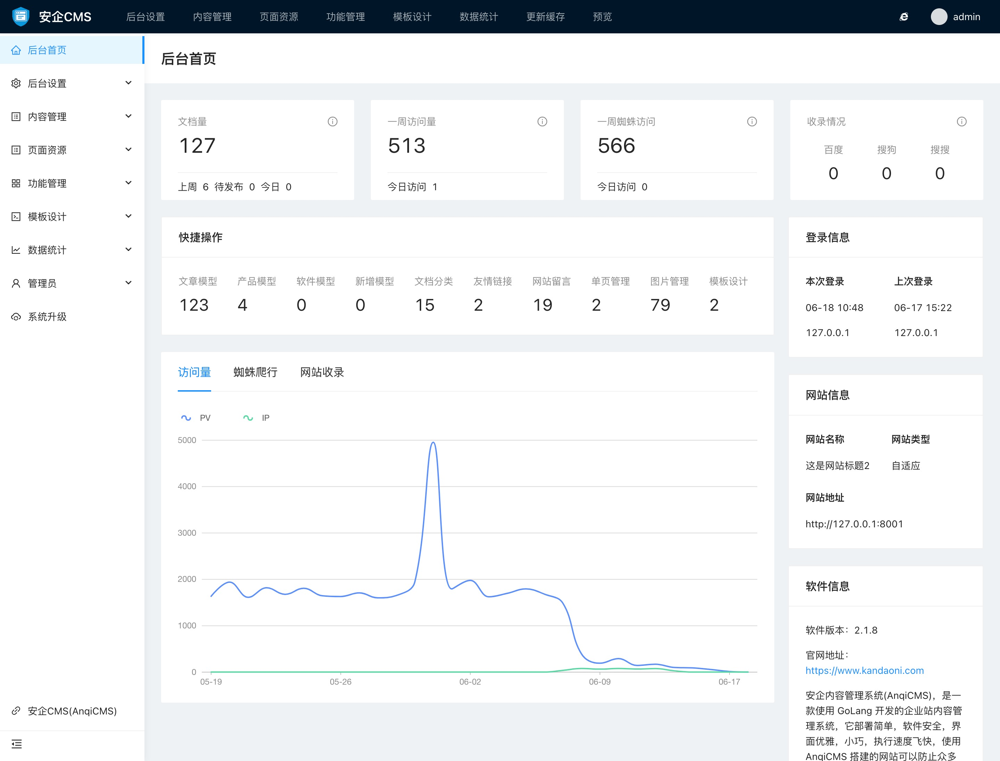

# AI内容管理系统(AICMS)后台功能介绍

AI内容管理系统(AICMS)后台提供了强大的内容管理功能和数据展示功能。按照不同的功能特点，AICMS将功能分为了10块，分别是：

- 后台首页
用于用户进入后台的着陆页，展示了文档数据、访问数据，以及收录数据等，同时还有快捷操作、数据图表等展示。

- 后台设置
后台设置提供了全局的功能设置、内容设置、联系方式设置、首页TDK设置、导航设置等功能。

- 内容管理
内容管理可以展示和发布、修改文档内容，管理文档分类、文档标签，以及文档模型等功能。

- 页面资源
页面资源可以管理单页面的展示和发布，以及图片、视频资源的管理。

- 功能管理
功能管理目前内置了15个常用的功能，分别包含有伪静态规则管理、链接推送管理、Sitemap管理、Robots管理、友情链接管理、内容评论管理、锚文本管理、网站留言管理、关键词库管理、内容素材管理、验证文件上传管理、邮件提醒管理、内容采集管理、内容导入接口管理、301跳转管理等功能。

- 模板设计
模板设计包含了网站模板管理、模板开发文档已经模板市场功能，可以在线编辑模板代码，查看模板开发文档手册。

- 数据统计
数据统计功能可以方便的查看蜘蛛访问记录图表、流量记录图表、详细的记录详情数据，以及百度、搜狗、搜搜、必应、谷歌搜搜引擎每天的收录数据情况。

- 管理员管理
管理员管理包含了管理员信息展示和修改、管理员登录记录，以及操作记录详细数据。

- 系统升级
系统升级提供了软件的在线升级服务。

- 更新缓存
可以及时清理系统的缓存数据，保证数据的更新。

### 后台首页界面展示

