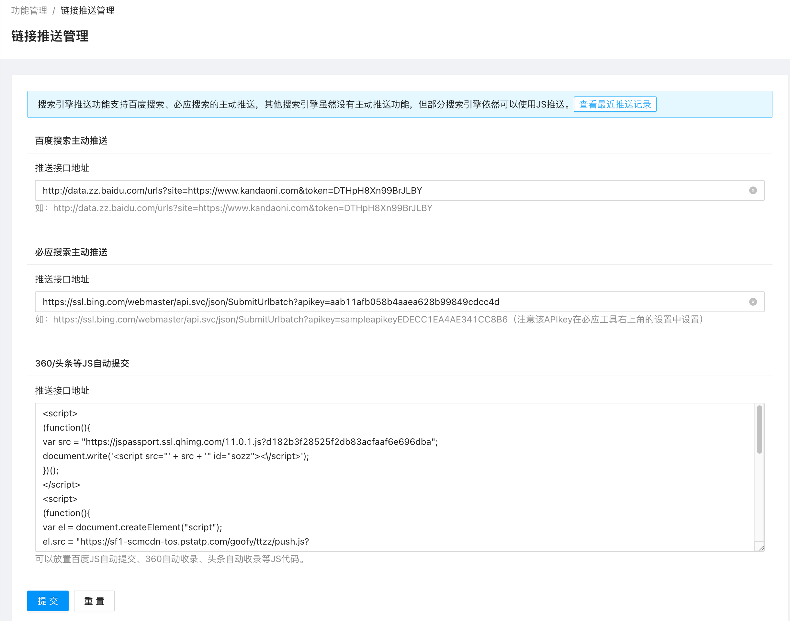
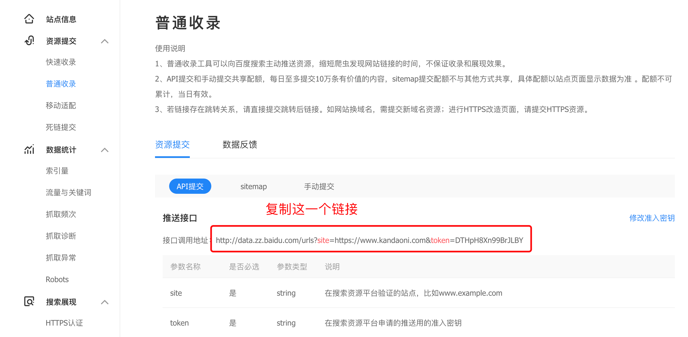
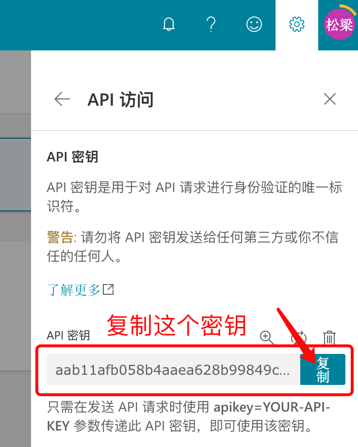
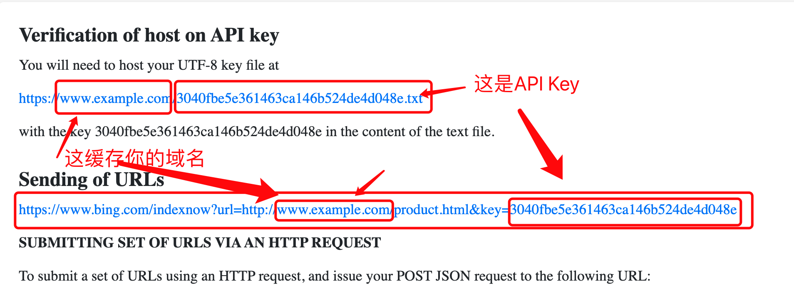
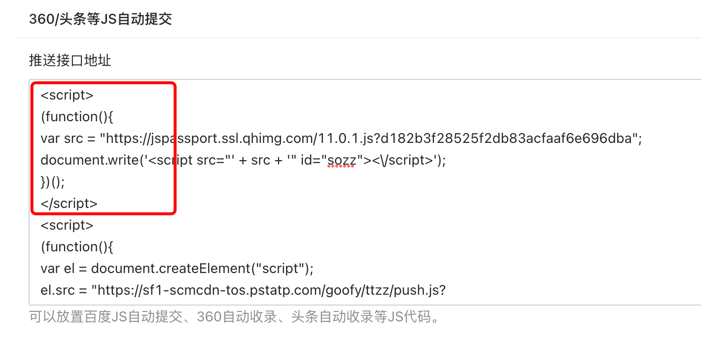
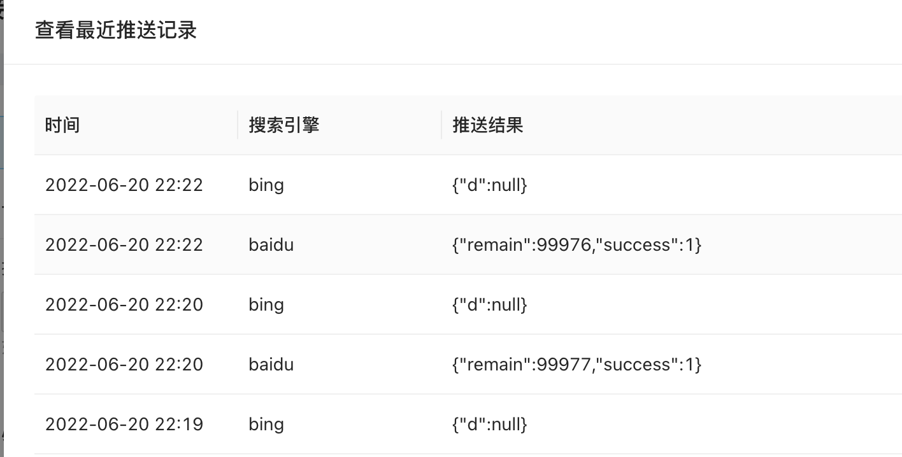

# 链接推送使用帮助

搜索引擎链接推送功能的使用，可以让你发布的文档，及时的告知各大搜索引擎，让他们的蜘蛛及时过来抓取页面，达到促进页面收录效果。

目前系统支持的主动推送的搜索引擎有：百度搜索、必应搜索。

### 百度搜索主动推送接口

需要使用百度搜索主动推送接口你需要从百度搜索资源平台 `https://ziyuan.baidu.com/` 上，找到普通收录 `https://ziyuan.baidu.com/linksubmit/index` ，并在资源提交中，选择API提交，在这个页面上，你就能看到推送接口了，将接口调用地址复制下来，粘贴到系统功能的百度搜索主动推送接口地址输入框上。如果你还没有在百度搜索资源平台上添加站点，你需要先添加站点 `https://ziyuan.baidu.com/site/index#/` 。

### 必应搜索引擎主动推送接口

必应搜索引擎主动推送接口的获取稍微有点麻烦，不过你按照我的步骤来操作，就可以顺利得到了。

必应搜索引擎主动推送提供了2种方式推送，分别是 新出的 `IndexNow API` 和 `提交 API`，两种方式都可以使用。 

1. 先访问Bing Webmaster Tool `https://www.bing.com/webmasters/`，并登录账号，如果你没有账号，请先注册一个账号。

2. 添加站点，根据你的实际情况，可以选择从 Google Search Console 导入，也可以手动添加，手动添加一般可以使用文件验证，或dns验证两种方式来验证你的网站。

3. 获取推送接口地址

    使用 `提交 API` 方式提交：

    点击右上角 齿轮图标的设置按钮，并复制 API 密钥。
    
    并和 `https://ssl.bing.com/webmaster/api.svc/json/SubmitUrlbatch?apikey=` 组成一起，构成一个完整的URL。如示例中的API 密钥是：`aab11afb058b4aaea628b99849cdcc4d` ，组装一起后，是：`https://ssl.bing.com/webmaster/api.svc/json/SubmitUrlbatch?apikey=aab11afb058b4aaea628b99849cdcc4d` 。注意不要留空格。并将这个链接粘贴到系统的必应搜索主动推送接口地址栏。

    使用 `IndexNow API` 方式提交：

    `IndexNow API` 方式提交，要求先验证你的网站。因此需要来到 `https://www.bing.com/indexnow` ，这个页面上会生成一个 API Key。
    
    你需要在你的站点的public目录下创建一个 {API Key}.txt 文件，并将 {API Key} 的内容写到txt文件中。例如示例中的 API Key为 `d2f0d24fc01e46c9be89c0d9b282227a`，则创建一个 `d2f0d24fc01e46c9be89c0d9b282227a.txt` 文件并添加内容 `d2f0d24fc01e46c9be89c0d9b282227a` 到txt文件中，上传到 网站的public 目录下。

    接着将API Key 和 `https://www.bing.com/indexnow?key=` 拼接一起，组成：，成为新的url `https://www.bing.com/indexnow?key=d2f0d24fc01e46c9be89c0d9b282227a`，并将链接粘贴到系统的必应搜索主动推送接口地址栏。
    
    这样就可以获得必应搜索引擎主动推送能力了。

### 360/头条等JS自动提交

由于其他搜索引擎并没有主动推送接口支持，只能使用放置js的形式触发推送。

因此你需要到360、头条等站长平台上，获取到js推送代码，并粘贴到这里的输入框中。

注意：需要连同``标签的开始和结束标签一起粘贴进来。

### 验证主动推送接口正确性

配置完成后，你需要测试下是否能正常推送，你需要到内容管理中，发布一篇文档，然后来到链接推送功能里，点开 查看最近推送记录，看看推送结果是否正常：

如果百度推送包含有 success 字样，表示推送正常，必应推送 包含{"d":null}也是正常的。如果不确定是否正常，可以到百度搜索资源平台查看数据反馈，看看是否有API提交的记录，但是百度的数据反馈不是实时的，需要隔天去看才能发现。必应的链接提交数据是实时反馈的，可以在URL提交中看到已提交的链接。