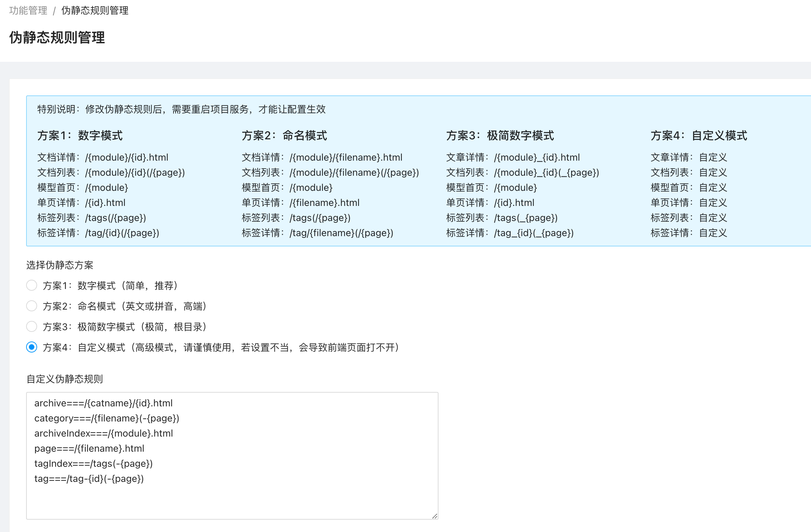
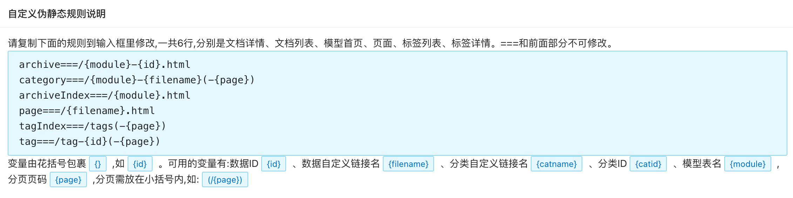

# 伪静态规则使用帮助

伪静态规则可以让你能够根据实际的需要，来定义网站的url组成形式。

为了方便用户，减少配置的麻烦，系统内置了4种现成的伪静态规则，只需要选择就可以直接使用。



默认的伪静态规则有：

1. 数字模式

    数字模式下，文档详情、文档列表、单页详情，文档标签，都使用`{id}`来作为URL生成依据，通常做中文站使用较多。

2. 模型命名模式

    模型命名模式，一般做英文站使用较多

3. 分类命名模式1

    分类命名模式1，一般做中文站用得较多

4. 分类命名模式2

    分类命名模式1，一般做英文站用得较多

为了让你可以能够自定义网站内容的链接展示形式，系统同时还提供了自定义模式。

自定义模式属于高级模式，在实际使用中，请务必按照要求配置，否则可能会导致页面打不开的问题出现。

自定义伪静态规则模式一共可设置6组伪静态规则，分别对应不同的页面，分别是文档详情、文档列表、模型首页、页面、标签列表、标签详情。===和前面部分不可修改。

自定义规则中，已经列出了一些可用的规则，你可以复制这些规则来进行进一步修改成符合你的需求的规则。

如规则：
```conf
archive===/{module}-{id}.html
category===/{module}-{filename}(-{page})
archiveIndex===/{module}.html
page===/{filename}.html
tagIndex===/tags(-{page})
tag===/tag-{id}(-{page})
```

在实际的规则配置中，每一条规则，都是由`规则名===规则值`来配对的。规则名有：`archive`、`category`、`archiveIndex`、`page`、`tagIndex`、`tag`。

规则值中，有一些常用的变量可供选择和使用。变量有花括号包裹`{}`,如 `{id}`。可用的变量有:数据ID `{id}`、数据自定义链接名 `{filename}`、分类自定义链接名 `{catname}`、分类ID `{catid}`、模型表名 `{module}`,分页页码 `{page}`,分页需放在小括号内,如: `(/{page})`。



通过变量的组合，你可以生成一些复杂的URL伪静态形式。