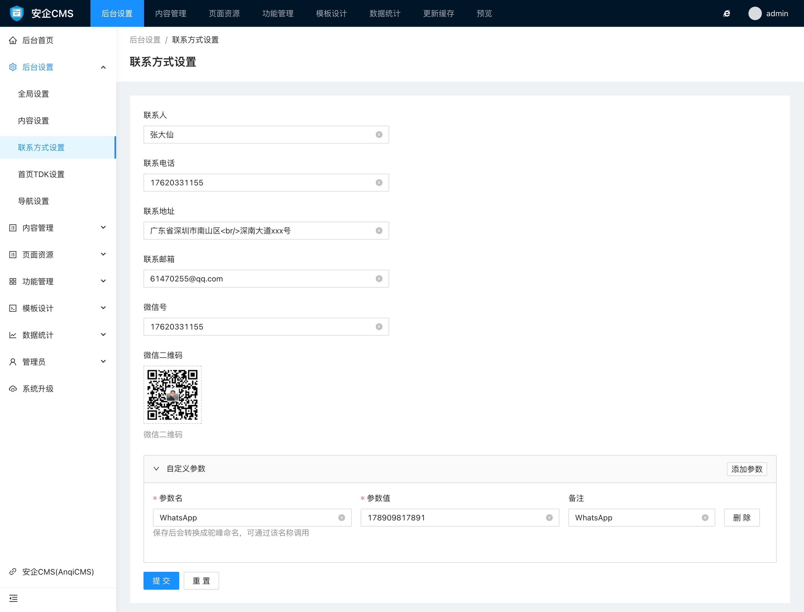

# 联系方式设置使用帮助

联系方式设置默认可设置联系人、联系电话、联系地址、联系邮箱、微信号、微信二维码信息，如果觉得默认的设置项不能满足需要，还可以自定义新的设置项。

### 默认的设置项可以设置的有：

- 联系人
一般上用于设置显示在前端联系方式上，用于给客户称呼使用的联系人，比如：王先生

- 联系电话
联系电话一般填写为用户可以联系上你的电话，在前台适当位置调用显示。

- 联系地址
同上，主要用于标记你的联系地址，方便客户能联系上你，在前端适当的位置调用，如页脚、联系我们等位置。

- 联系邮箱
同上，主要用于方便用户给你发邮件，方便客户能联系上你，在前端适当的位置调用，如联系我们等位置。

- 微信号
同上，主要用于方便用户加你好友，方便客户能联系上你，在前端适当的位置调用，如页脚、联系我们等位置。

- 微信二维码
同上，主要用于方便用户扫码快速加你好友，方便客户能联系上你，在前端适当的位置调用，如页脚、联系我们等位置。

### 自定义设置参数

当内置的参数无法满足于你的模板调用需求的时候，你可以通过自定义参数设置，增加一些你需要调用的参数，如示例中，我们增加了 WhatsApp联系方式 `WhatsApp` 这个自定义参数，模板调用的时候可以通过 `WhatsApp` 来调用WhatsApp联系方式展示给用户。

这里需要注意的地方有：

- 参数名
是指供模板调用的名称，字母会自动转换为驼峰命名，也就是每个单词首字母大写，中间没有空格。这里也可以设置参数名为中文，但建议是设置为英文。

- 参数值
参数值则是模板调用参数名后，输出展示的内容。

- 备注
备注不会被模板调用，仅仅是用于让你更好的标识这个自定义参数的用途，以便后续查看和更改。
