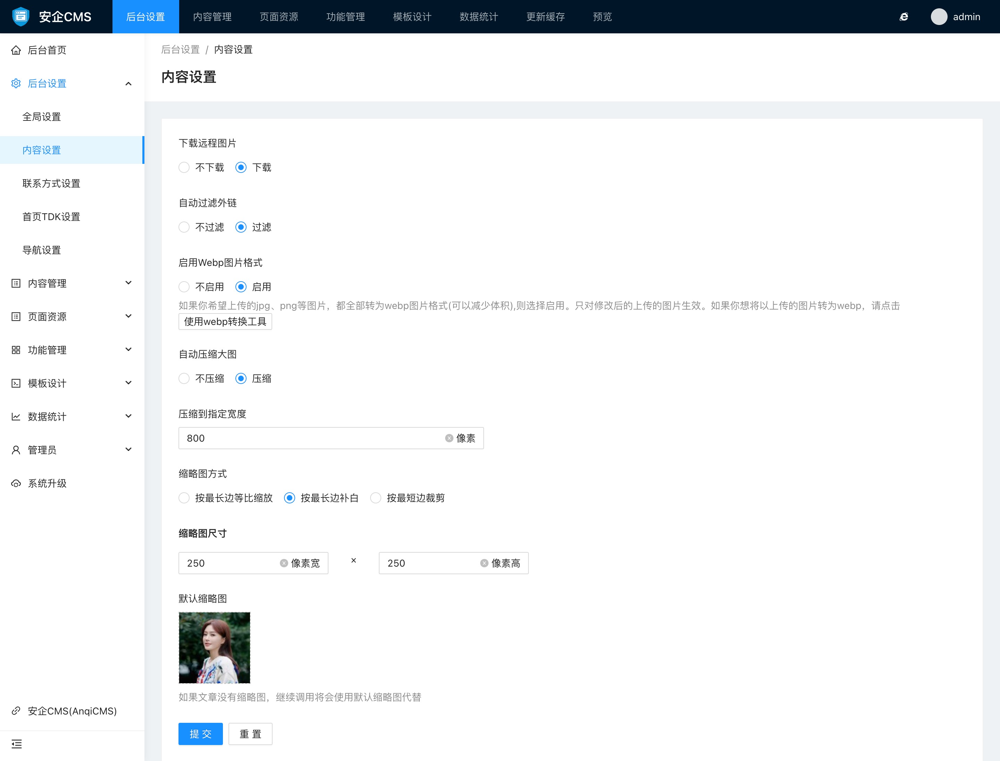

# 内容设置使用帮助

内容设置提供了对内容图片的处理方式设置。

#### 内容设置中可以设置的有：

- 是否下载远程图片
可以设置为下载和不下载，如果设置为下载远程图片，则会将引用的外部链接的图片下载到本地。如果你使用的是自己的图床，则不需要选择下载远程图片。

- 是否自动过滤外链
当你不希望你发布的内容中，有外部站点的链接，可以选择过滤外链。这样在发布文档的时候，检测到有外部链接就会被自动清除。如果选择不过滤外链，外链的链接会得到保留，但是会被加上 `rel="nofollow"` 标签。

- 是否启动Webp图片格式
如果你希望上传的jpg、png等图片，都全部转为webp图片格式(可以减少体积),则选择启用。选择启用webp格式后，所有的图片都会转换为webp格式，对大图片，可以减少很多存储空间。选择开启后，只有从开启之后上传的图片会自动转换为webp图片格式。如果你希望那些已经上传了，但不是webp图片格式的图片也转换成webp，则可以使用附带的webp转换工具来批量自动转换整站的图片为webp图片格式。

- 是否自动压缩大图
系统提供了自动压缩大图的功能。如果你不需要按照你上传的原尺寸显示图片，则可以启用自动压缩大图功能，这样可以减少不少存储空间。默认关闭，如果开启了，则默认会压缩到800宽度。

- 自动压缩到指定宽度
当你开启了自动压缩大图，则会出现自动压缩到指定宽度输入框，默认为800像素宽度。你可以根据实际需要，设置其他宽度的尺寸。压缩大图只根据图片宽度判断压缩。

- 缩略图处理方式
系统提供了3种缩略图处理方式，分别是：
  - 按最长边等比缩放
  这种方式可以完整显示图片所有边，缩略图图片宽度或高度有一边是固定的，另一边会根据图片实际比例，等比缩放。
  - 按最长边补白
  这种方式处理图片的宽度和高度都是固定的，并且图片的所有边都会完整显示出来，图片会居中显示，图片不足的部分，会用白色色块来填充到指定的缩略图尺寸大小。
  - 按最短边裁剪
  这种方式处理图片会将图片进行居中裁剪，最短边可以完整显示，最长边则会被居中裁剪到和最短边匹配的长度。会因为裁剪导致最长边的边沿被裁剪掉而丢失。

- 缩略图尺寸
你可以根据前端页面需要，设置缩略图的尺寸大小，建议设置合适的尺寸，可以减少图片体积，加快页面加载速度。

- 默认缩略图
可以给文档设置一个默认的缩略图，如果你的文档没有上传缩略图，继续调用将会使用默认缩略图代替展示。如果你的网站有统一格式展示需求用到默认缩略图的，可以在这里上传。

- 批量重新生成缩略图
系统提供了批量重新生成缩略图功能，你可能修改了图片缩略图的尺寸，需要重新生成所有缩略图为新的尺寸，则可以使用这个功能，来重新按新的尺寸生成所有的缩略图。