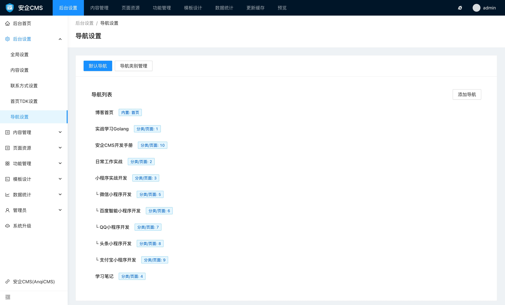
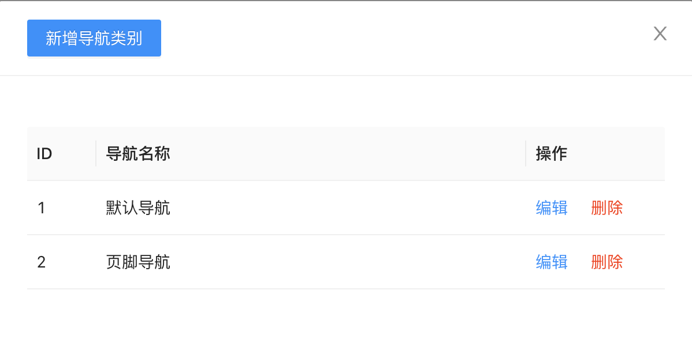
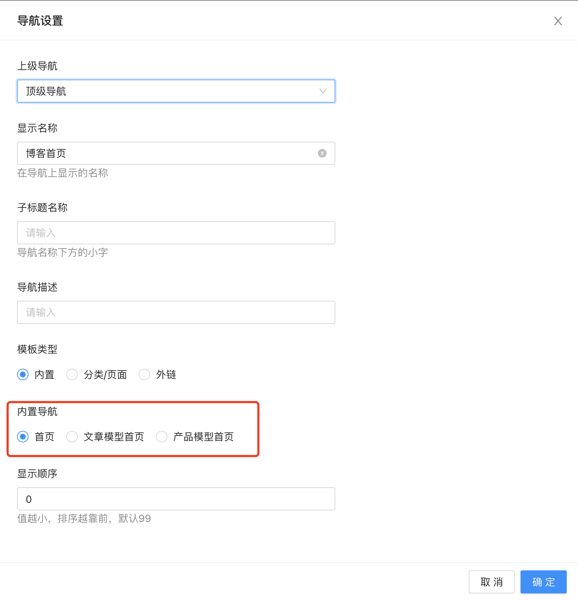
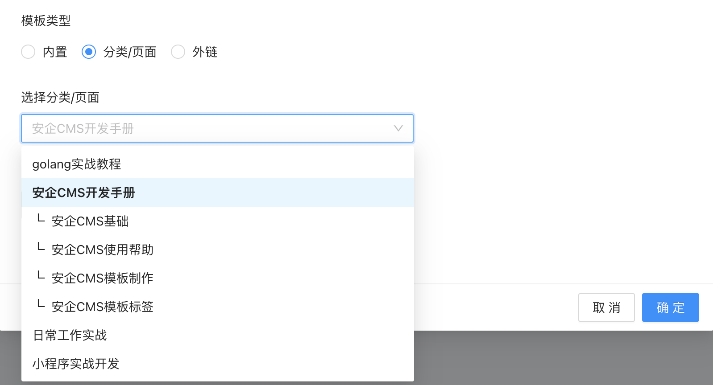
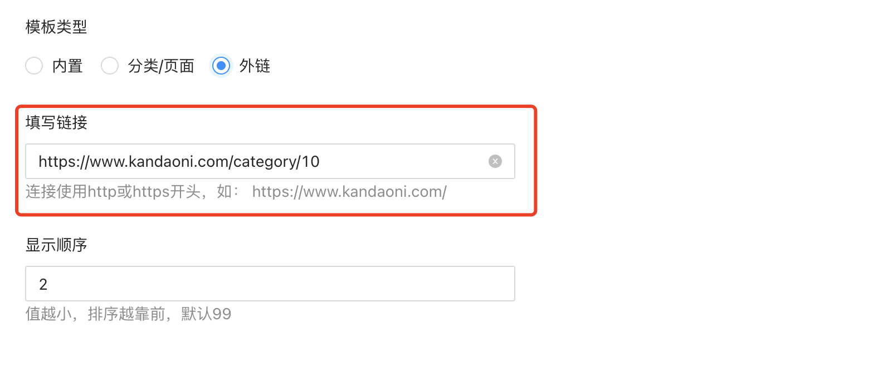

# 网站导航设置使用帮助

网站导航设置网站的导航链接，并用于网站前台的展示。除了设置默认的顶部导航内，还可以根据自身需要，添加其他的位置导航，比如页脚导航、侧边栏导航等形式的自定义导航内容。

导航列表中，可以支持最多2级的导航链接，也就是只支持一级下拉导航链接。

### 导航类别管理

默认设置中，系统内容了默认导航这一个类别，如果你有需求需要定制其他的导航，比如页脚导航，可以通过自定义导航类别中，新增导航类别，比如添加一个：页脚导航

增加后，就可以给这个导航类别，添加导航链接了。

### 导航链接设置

导航链接中，可以设置的选项有：

- 上级导航
导航链接支持2级导航链接，所以你可以通过设置上级导航的方式，来设置当前链接为一级导航还是二级导航，选择顶级导航，则表示当前链接是一级导航，在最上层列表显示，设置为具体的导航的时候，就只能显示在设置的导航下的子导航下显示。

- 显示名称
显示名称为导航显示在前台页面的文字名称，可以方便灵活的更改显示名称，不一定要和链接类型完全一致。

- 子标题名称
有些导航显示上，需要显示双标题，比如显示了中文，还想显示英文，则可以在子标题上添加上个对应文字，用于前台的调用显示。

- 导航描述
有些导航显示上，会给当前导航显示一段简介文字，则可以通过设置导航描述，来达到导航上显示简介文字的目的。

- 链接类型
链接类型支持三种类型的链接，分别是：

  - 内置链接
  内置链接有 `首页链接`、 `文字模型首页`、 `产品模型首页`，其他自定义模型首页。
  
  - 分类页面链接
  分类页面链接可以选择已有的分类、页面作为导航链接。
  
  - 外部链接
  外部链接可以灵活的添加各种网页链接，可以是站内链接，也可以是站外的链接。
  

- 显示顺序
显示顺序的作用，是用于给导航链接做排序用的，比如我希望后来添加的链接，显示在第一位，则通过设置显示顺序的数字为小于其他链接的显示顺序数字，就可以将它排到前面。

目前暂时不支持拖拽排序，后续会增加支持。