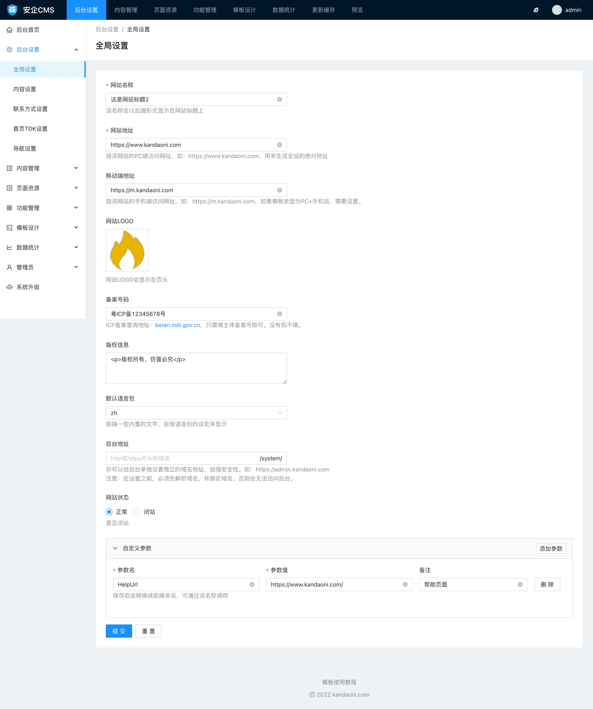

# 全局功能设置使用帮助

全局功能设置默认的设置项，如果觉得默认的设置项不能满足需要，还可以自定义新的设置项。

### 默认的设置项可以设置的有：

- 网站名称
网站名称会作为网站标题后缀附加到网页标题上，一般填写网站品牌名，比如设置为：AICMS。

- 网站地址
网站地址是指用户访问的地址，如果填写的是域名，填写之前，需要先将域名解析到服务器上。一定要设置正确，否则会导致页面打不开，因为前台用户访问的页面，会以这个网址为基础显示和加载网站资源。

- 移动端地址
是指手机端访问的网址。一般上不需要设置，只有在网站使用的模板是 电脑端+手机端 的模板模式的时候，才需要填写移动端地址。同样，填写之前，请解析好域名到服务器上，否则也会导致移动端无法正常访问。

- 网站LOGO
可以在这里上传你的网站LOGO图标，用于模板调用并展示在网页上。

- 备案号码
如果你的网站有备案，可以在这里填写上你的网站备案号，不需要填写 -1 的后缀，可以给模板调用生成备案号链接信息。

- 版权信息
一般用于模板在网页页脚的调用信息。

- 默认语言包
语言包目前内置了中文、英文两种语言，设置了语言包后，用于访问的时候，一些内置的展示信息，会按选定的语言站。注意，这里只是会修改内置的文字，而模板上的文章，以及文档。分类等内容文字，并不会因为这里设置的语言包而跟随变动。

- 后台域名地址
你可以给后台单独设置独立的域名地址，加强安全性。如：https://admin.kandaoni.com
注意：在设置之前，必须先解析域名，并绑定域名，否则会无法访问后台。

- 网站状态
可以设置你的网站用户能否访问到里面的内容，当你选择为闭站状态下，用户将只会看到闭站提示信息。

- 闭站提示
用于网站在闭站状态下，展示给用户看到的信息。

### 自定义设置参数

当内置的参数无法满足于你的模板调用需求的时候，你可以通过自定义参数设置，增加一些你需要调用的参数，如示例中，我们增加了 帮助页面 `HelpUrl` 这个自定义参数，模板调用的时候可以通过 `HelpUrl` 来调用帮助页面的链接地址。

这里需要注意的地方有：

- 参数名
是指供模板调用的名称，字母会自动转换为驼峰命名，也就是每个单词首字母大写，中间没有空格。这里也可以设置参数名为中文，但建议是设置为英文。

- 参数值
参数值则是模板调用参数名后，输出展示的内容。

- 备注
备注不会被模板调用，仅仅是用于让你更好的标识这个自定义参数的用途，以便后续查看和更改。
