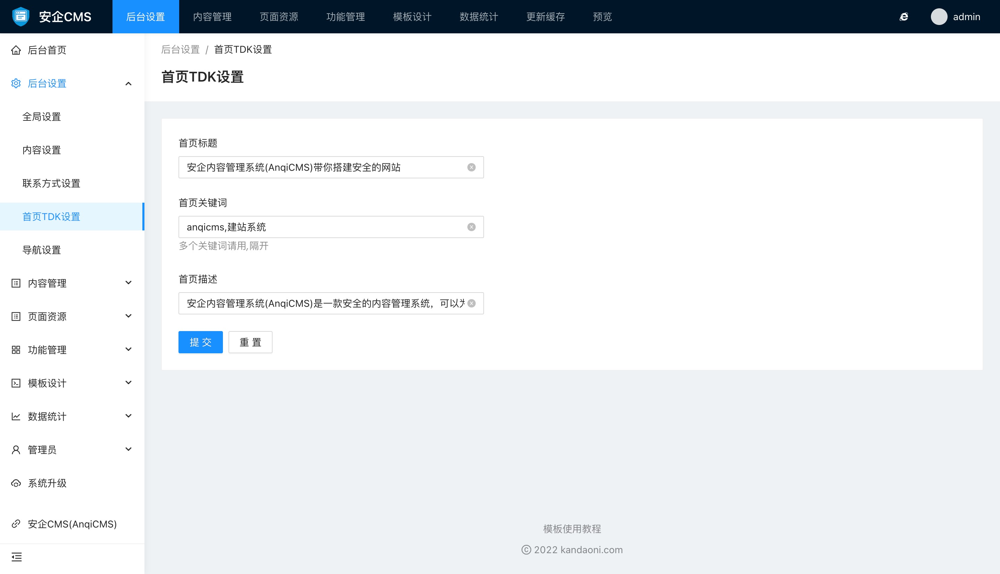

# 首页TDK设置使用帮助

首页TDK设置可以设置网站首页的title、keywords、description 三个标签的内容。

#### 首页TDK设置中可以设置的有：

- 首页标题
首页标题将在首页中的`<title></title>` 标签中显示，为首页优化带来更好的体验。

- 首页关键词
首页关键词将在首页中的`<meta name="keywords" content="">` 标签中显示，用于设置需要优化整站的核心关键词。适当设置关键词可以让网站具有更好的收录效果

- 首页描述
首页描述将在首页中的`<meta name="description" content="">` 标签中显示，也是网站优化的的设置项，请根据自身网站需求合理设置。
