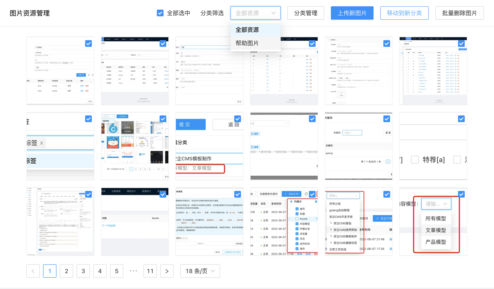
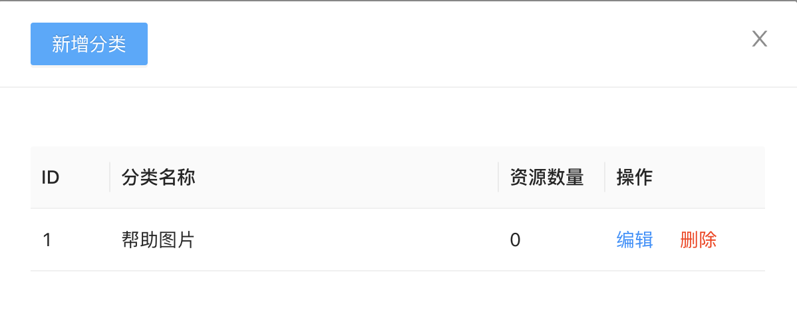
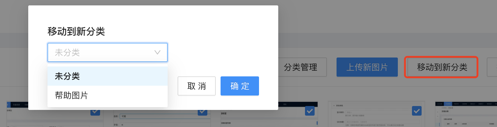
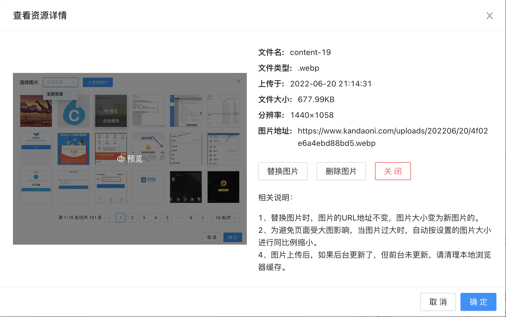

# 图片资源管理使用帮助

图片资源管理帮助功能页面中，包含了网站上传的所有图片，以及视频资源。你可以在这里可以轻松的管理你网站的图片和视频资源。

你可以对图片资源按不同的分类进行归类操作，在管理界面上可以进行分类管理，添加你需要的分类。

在图片资源管理中，可以批量选择图片，并对图片进行删除、批量转移图片到指定分类的操作。

点击图片，可以来到图片资源的详情界面，在详情界面上可以查看图片的原始大图，还可以查看图片的其他信息，如：文件名、文件类型、上传时间、文件大小、图片分辨率、图片地址等信息。

除了基本信息外，还可以在图片资源详情界面，进行图片替换操作、图片删除操作等。

注意事项：
进行图片替换时，图片的URL地址不变，图片大小变为新图片的大小。
为避免页面受大图影响，当图片过大时，自动按内容设置中压缩图片的图片大小进行同比例缩小。
图片上传后，如果后台更新了，但前台未更新，请清理本地浏览器缓存。
