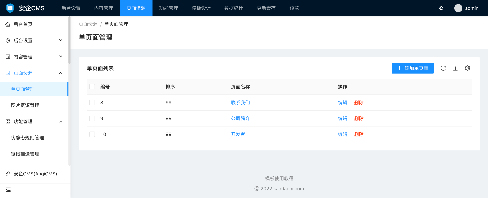
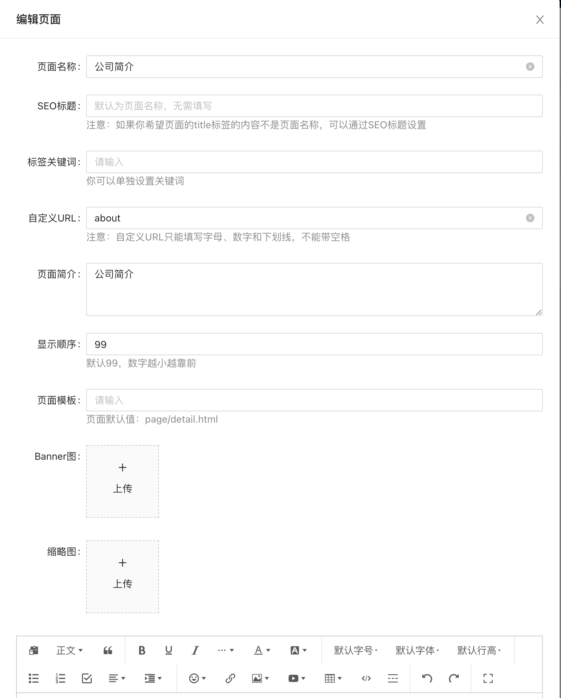

# 页面管理使用帮助

单页面管理可以管理创建的单页，例如帮助我们、联系我们等页面。

通过单页面管理界面，你可以快速的查看当前的单页面列表，以及添加单页面、编辑修改、删除等操作。

单页面添加和编辑的表单中，你可以输入的内容有：

- 页面名称
页面名称则为单页面的前台显示名称。

- SEO标题
SEO标题是用于展示给搜索引擎看到标题内容。注意：如果你希望页面的title标签的内容不是单页面名称，可以通过SEO标题设置

- 关键词
单页面关键词可以手动输入填写。多个关键词之间请使用英文的 `,` 来区分，因为这样更符合搜索引擎收录的习惯。你也可以不设置。

- 自定义URL
自定义URL是为了给启用命名模式的伪静态规则调用的。也只有在网站伪静态规则使用了`{filename}`、`{catname}`这个字段的命名模式下，自定义URL才生效。
默认自定义URL会根据你输入的单页面名称，自动根据拼音生成。如果你对自动生成的不满意，可以通过手动输入来设置自定义内容。需要注意的是，自定义URL必须保证唯一，如果不是唯一的，则系统会在后面添加随机数字让它保证唯一。

- 单页面简介
单页面简介为单页面的介绍，同时也是tdk标签中的description标签的调用内容。

- 显示顺序
显示顺序可以决定这个单页面的排序，数字越小，显示越靠前。默认创建的时候，默认值为99。

- 单页面模板
你可以给单页面设置自定义的模板，默认的模板为`page/detail.html`，你可以根据实际需要设置为其他名称的模板名称。注意，你一定要保证该模板是存在于你的模板设计包里的，否则会导致这个单页面打不开。如你创建了一个 `download.html` 模板，用于展示这个单页面，则在这里，填写上 `download.html`。

- Banner图
有些单页面可能需要展示一些banner轮播图片，你可以在这里设置。你可以上传多张图片。注意上传的时候，请使用相同尺寸的图片。

- 缩略图
单页面的缩略图不是必须的，当你需要在前台页面调用单页面缩略图的时候，才需要上传。

- 单页面内容
单页面内容不是必须的，只有当你需要在前台页面调用单页面内容的时候，才需要填写。单页面内容编辑器功能丰富，支持各种文本操作。