# AICMS 安装步骤教程

## 支持的系统
支持 Windows 10、Windows 11、Windows Server 2016以上 各个版本。 不支持 Windows 7及以下，Windows Server 2012及以下版本。
支持 Ubuntu、Centos、Red Hat、Debian 等 基于 X86 的 Linux 版本。
支持 MacOS。

## Linux服务器上部署AICMS

先从 [https://www.aicms.com/download](https://www.aicms.com/download) 下载 AICMS Linux 安装包。

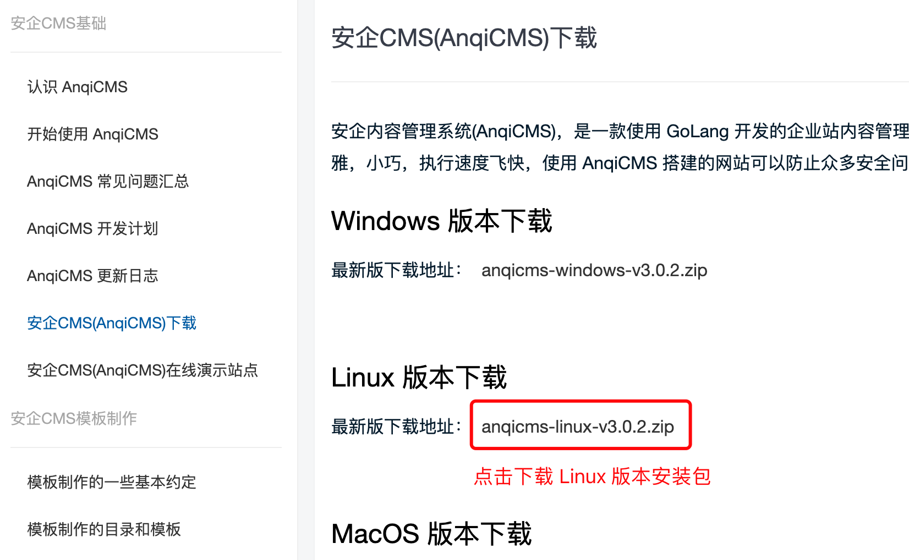

### 宝塔上部署

#### 首次安装：

宝塔面板7.9.3版本以上支持更快捷的部署，建议升级宝塔面板到7.9.3以上版本。

##### 创建目录和上传安装包

1. 点击左侧菜单的 `文件` 菜单，切换目录到 `/www/wwwroot/` 目录，在 `wwwroot` 目录下创建一个新目录，目录一般以域名命名，如 `aicms.com`。如图：

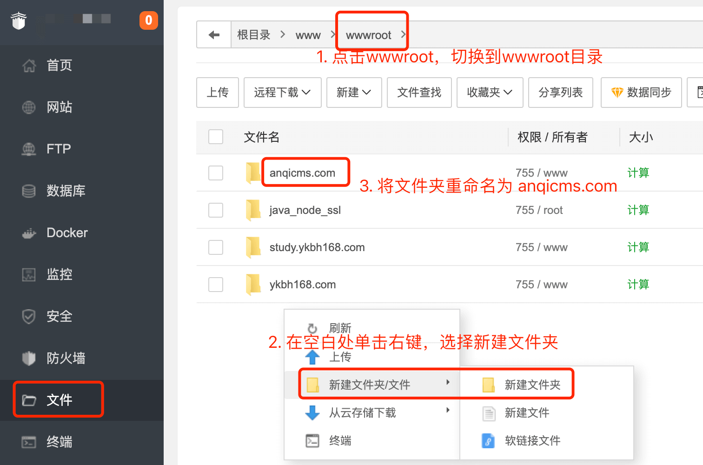

2. 点击 `aicms.com`，进入 `aicms.com` 文件夹，将Linux安装包 `AICMS-linux-v3.x.x.zip` 上传到当前目录。在安装包 `AICMS-linux-v3.x.x.zip` 上单击右键，选择解压，将安装包解压到当前文件夹。如图：

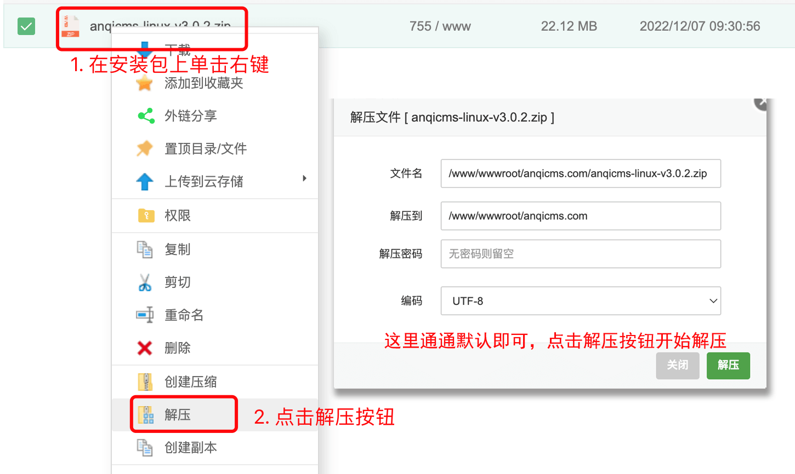

##### 宝塔面板7.9.3版本以上部署：

点击左侧菜单的 `网站` 菜单，点击 `Go项目`，来到Go项目网站创建页面，点击 `添加Go项目` 按钮，在弹出的弹窗中，进行配置。项目执行文件选择 `/www/wwwroot/aicms.com/AICMS`；项目名称填写 `AICMS`；项目端口 填写 `8001`；执行命令填写 `/www/wwwroot/aicms.com/AICMS` ；运行用户选 `www`；并勾选开机启动，备注可以按需填写，默认即可；绑定域名填写你解析到服务器的域名。填写完成后，点击提交按钮，完成添加。如图：

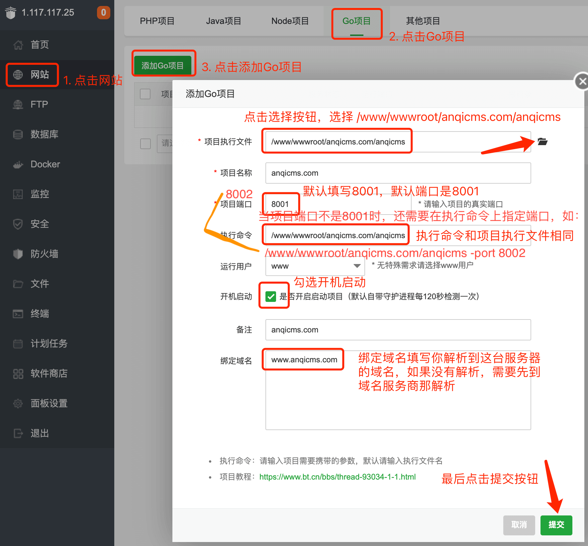

##### 在旧版宝塔部署：

旧版没有使用Go项目部署，则选择其他项目部署。

点击左侧菜单的 `网站` 菜单，点击 `其他项目`，来到其他项目网站创建页面，点击 `添加通用项目` 按钮，在弹出的弹窗中，进行配置，配置项和宝塔7.9.3版本以上版本填写内容一致。项目执行文件选择 `/www/wwwroot/aicms.com/AICMS`；项目名称填写 `AICMS`；项目端口 填写 `8001`；执行命令填写 `/www/wwwroot/aicms.com/AICMS` ；运行用户选 `www`；并勾选开机启动，备注可以按需填写，默认即可；绑定域名填写你解析到服务器的域名。填写完成后，点击提交按钮，完成添加。

##### 初始化安装网站

在浏览器中 访问你绑定的域名，来到 AICMS初始化安装界面，填写数据库信息，后台账号密码信息，以及网站地址。如图：

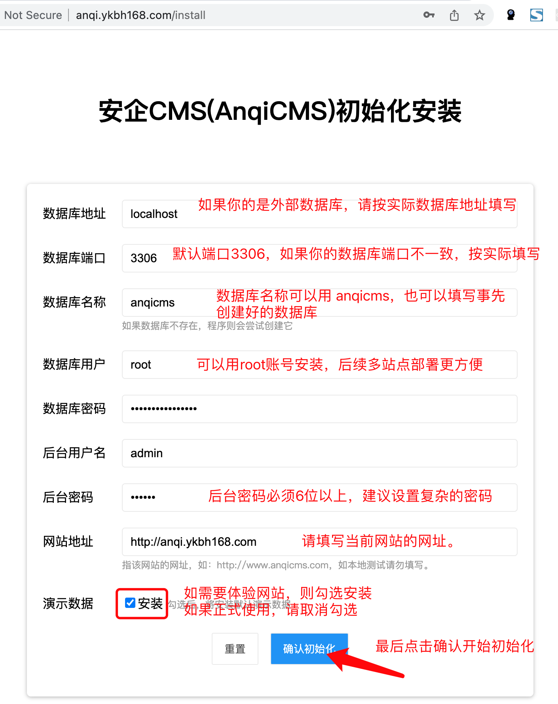

如果安装失败，可能出现的情况有：1，数据库账号密码不正确，请重新检查数据库账号密码。2. 数据库账号权限不足，无法创建数据库，请提前创建数据库或使用更高权限的账号。3. 管理员密码长度不足，请设置更复杂的密码。

安装成功后，访问前台和后台，检查是否一切正常。

如果安装失败，可能出现的情况有：1，数据库账号密码不正确，请重新检查数据库账号密码。2. 数据库账号权限不足，无法创建数据库，请提前创建数据库或使用更高权限的账号。3. 管理员密码长度不足，请设置更复杂的密码。

安装成功后，访问前台和后台，检查是否一切正常。

#### 一台服务器上安装多站点：

AICMS 在一台服务器上安装多个站点不需要复制多份AICMS代码，请按下面操作流程来添加多个站点。

1. 在宝塔面板左侧菜单中，点击 `网站` 菜单，点击`PHP项目`，添加一个PHP站点，在创建站点中，填写已解析到服务器上的域名，根目录按默认即可，复制根目录地址，等会下一步要用到，FTP、数据库均选择不创建，PHP版本选择纯静态。最后点击提交。如图：

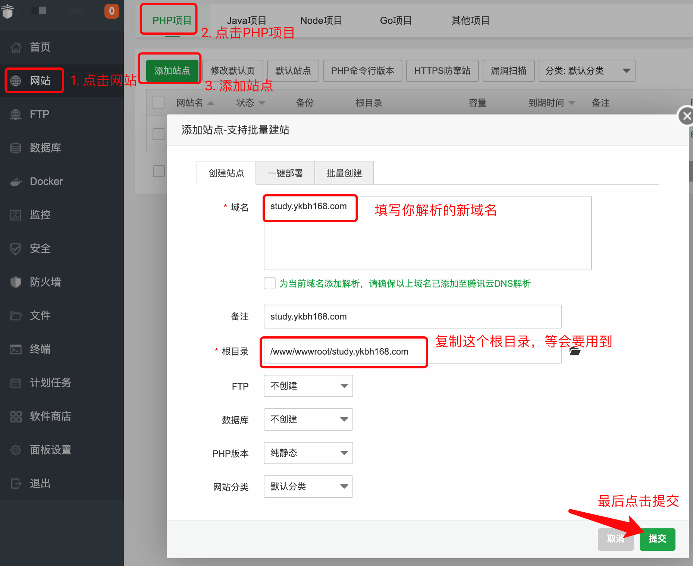

2. 登录站点后台，在左侧菜单中点击 `多站点管理` 菜单（只有默认安装的站点具有多站点管理权限）。在多站点管理界面中，点击添加新站点按钮。在弹出的弹窗中，根据实际填写表单。站点名称按实际情况填写，方便区分不同站点；站点根目录请填写一个新目录，粘贴第一步复制的站点根目录，如：`/www/wwwroot/study.ykbh168.com`，新目录需要提前在服务器上创建；站点网址填写新网址，这个网址也需要提前解析到服务器上。管理员账号和管理员密码是新站点管理员账号密码；数据库名称需要是一个新的数据库，不要填写已存在的站点的数据库，否则会导致数据覆盖，如果默认安装使用root账号安装，可以选择复用数据库账号，免去填写账号信息。最后点击确定按钮，完成新站点的创建。如图：

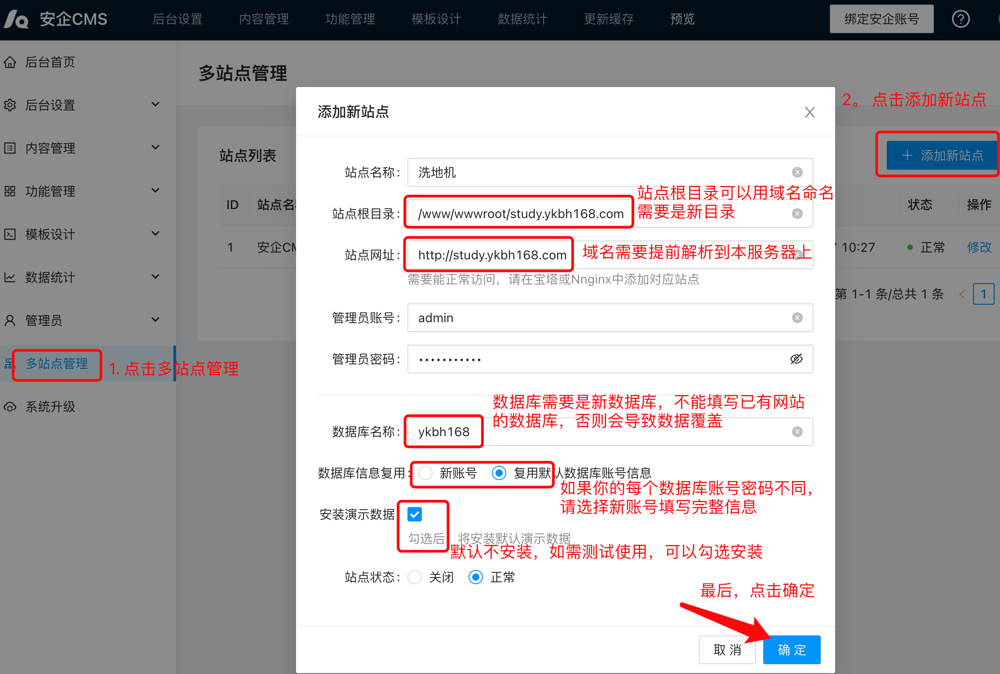

3. 在宝塔中，新建的网站操作栏中点击设置，在弹出的界面中，选择 `网站目录` 菜单，更改运行目录为 `/public`，点击保存。如图：

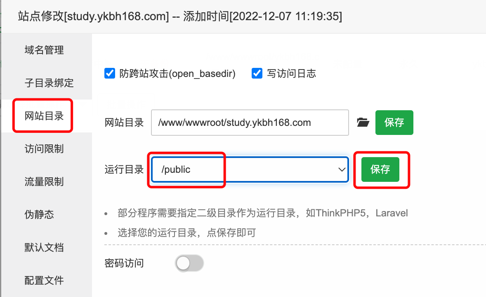

4. 伪静态设置

- Nginx 伪静态设置
选择 `伪静态` 菜单，填写伪静态规则，并点击保存，可以点击另存为模板，方便下次使用：

```conf
    location @AICMS {
        proxy_pass http://127.0.0.1:8001;
        proxy_set_header   Host             $host;
        proxy_set_header   X-Real-IP        $remote_addr;
        proxy_set_header   X-Forwarded-For  $proxy_add_x_forwarded_for;
    }
    error_page 404 =200  @AICMS;
    location / {
       try_files $uri $uri/index.html @AICMS;
    }
```

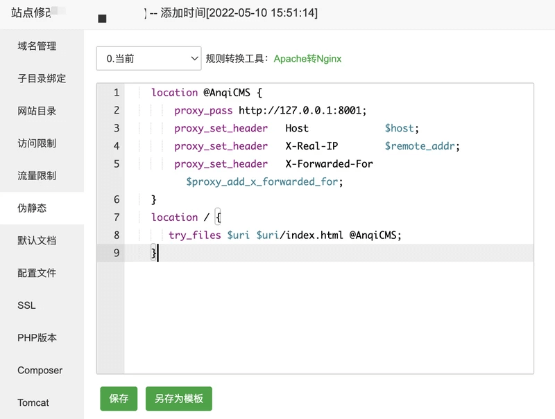

- Apache 伪静态配置

 如果你使用的 Apache软件，则伪静态规则会不一致。伪静态一栏请留空，选择反向代理，在目标URL中填写 `http://127.0.0.1:8001`，如图：

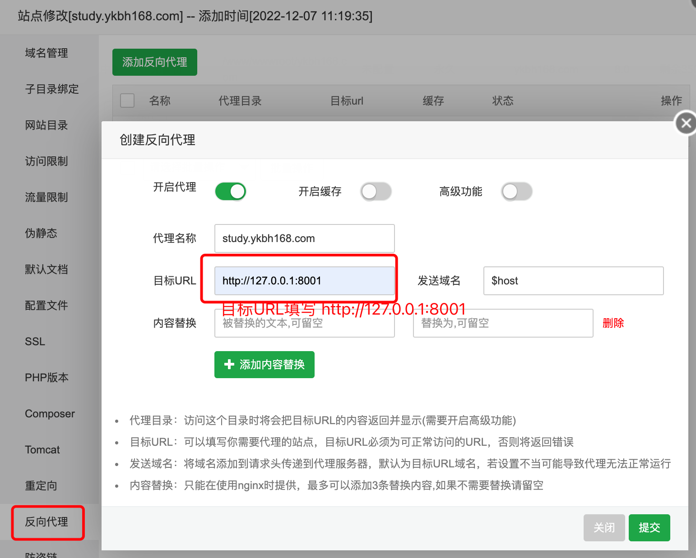

这样新站点就添加完成了。

### 命令行下部署安装AICMS

如果你的服务器没有安装可视化的环境管理软件，使用的是 `lnmp.org` 的LNMP一键安装包环境，或者是自行编译的服务器环境，包括本地的Linux桌面版，如Ubuntu、CentOS桌面版等，都可使用命令部署。以下操作默认认为你已经安装好了LNMP环境了。

1. 从官网下载 Linux版本的AICMS安装包，并将安装包解压到指定位置。假设解压到 `/www/wwwroot/aicms.com` 目录。

2. 添加启动计划任务：
```bash
crontab -e
```
在打开的编辑界面中，添加一条命令
```bash
*/1 * * * * /www/wwwroot/aicms.com/start.sh
# ws 保存并退出。
```

这里要注意，如果你手动修改了AICMS可执行文件名，则需要手动打开start.sh编辑，将里面的AICMS改成对应的新文件名。

添加计划任务后，再顺手执行一次：
```bash
./start.sh
```

3. 配置 Nginx 站点

一般上，还需要配置nginx代理，来使用80端口或https端口。下面以站点跟目录为 /www/wwwroot/aicms.com，域名 dev.aicms.com 配置为例：

我们需要将网站的运行目录，也就是nginx 的 root 目录配置到站点目录下的public目录。

并设置反向代理，目标URL：http://127.0.0.1:8001

nginx代理代码如下：
```conf
    location @AICMS {
        proxy_pass http://127.0.0.1:8001;
        proxy_set_header   Host             $host;
        proxy_set_header   X-Real-IP        $remote_addr;
        proxy_set_header   X-Forwarded-For  $proxy_add_x_forwarded_for;
    }
    error_page 404 =200  @AICMS;
    location / {
       try_files $uri $uri/index.html @AICMS;
    }
```
完整的nginx配置：

```conf
server
{
    listen       80;
    server_name www.aicms.com m.aicms.com;
    root /www/wwwroot/aicms.com/public;

    location @AICMS {
        proxy_pass http://127.0.0.1:8001;
        proxy_set_header   Host             $host;
        proxy_set_header   X-Real-IP        $remote_addr;
        proxy_set_header   X-Forwarded-For  $proxy_add_x_forwarded_for;
    }
    error_page 404 =200  @AICMS;
    location / {
       try_files $uri $uri/index.html @AICMS;
    }
    access_log access.log;
}
```
nginx设置完成，重启nginx来让配置生效。

4. 多站点的配置

只需要重复上面第三步，需要变动的地方只有2处，分别是 server_name 和 root，server_name 填写新的域名，root 填写新的站点根目录。
添加了Nginx站点后，再到 AICMS 后台多站点管理中，添加对应的站点即可。

### 从 AICMS 2.x 版本升级到 3.x 版

由于 AICMS 2.x 版吧服务器安装部署教程较为复杂，容易导致一些问题出现，而普通用户无法自行排查解决，并且，2.x版本不支持后台重启功能，因此这里建议升级使用3.x版本。升级方法如下：

1. 选择第一个安装的站点作为默认站点，登录网站后台，从后台升级到最新版。升级完成后，通过原来的计划任务，进行站点的重启。如果尝试重启后，后台版本没有更新为新版，则可以采用结尾的常见问题方法解决。

2. 先用计划任务停止项目，再删除掉计划任务。

3. 按 [宝塔面板7.9.3版本以上部署](#宝塔面板7.9.3版本以上部署) 方法开始添加为Go项目。添加项目的时候，选择的执行文件为第一个站点的AICMS可执行文件，端口为第一个站点的端口。添加完项目后就可以恢复网站访问了。不会进入初始化步骤。

4. 如果原来已经在服务器上安装了多套 AICMS，则现在需要在计划任务中，把它们都停止掉，然后将计划任务删除。接着，按[一台服务器上安装多站点](#一台服务器上安装多站点)的方法部署成新站点。注意，添加新站点的时候，填写的站点根目录为对于站点原来的根目录，数据库信息为对于站的原来数据库和账号信息，这样它会自动继承原站的数据，不会进入初始化安装步骤。

以上方法可以将多站点合并到使用一个AICMS部署管理。不做以上变更不影响实际使用。

## Windows 上测试使用AICMS

Windows 上可以测试使用AICMS，并做本地开发调试使用。Windows上，也建议安装使用 宝塔软件 管理环境，或安装使用 小皮(phpStudy) 软件开发环境。

从官网下载 Windows 版本的安装包，可以放到任意目录。解压缩到指定文件夹中，例如解压到AICMS 文件夹，进入文件夹，双击运行 AICMS.exe 文件，即可测试使用了。需要在本地运行多站点，则需要配合 宝塔软件 或 小皮(phpStudy) 软件，通过其管理界面的网站菜单，添加多个站点，在伪静态规则中添加伪静态规则。伪静态规则可按[伪静态设置](#伪静态设置)中设置方式添加。本地的测试域名，需要写入到 `hosts` 中。

### Windows 上如何停止或关闭AICMS

Windows上关闭AICMS需要借助Windows自带的任务管理器。
按 Win键+R，调出 运行窗口，输入 `taskmgr` 打开任务管理器，或者在任务栏，单击右键，选择任务管理器。在任务管理器中，找到 `AICMS.exe` 然后点结束按钮，结束它。

## MacOS 上测试使用AICMS

MacOS上可以测试使用AICMS，并做本地开发调试使用。MacOS上，需要自行先安装MySQL 和 Nginx 环境。

从官网上下载 MacOS版本的安装包，可放到任意目录，解压缩，并双击运行目录内的AICMS文件，即可测试使用了。多站点的测试方法，可按[命令行下部署安装AICMS](#命令行下部署安装AICMS)方法进行，使用域名需要先写入到 `/etc/hosts` 中。

## 安装过程中常见错误

1. 端口已被占用。

在服务器上反复安装、安装多个AICMS的时候，可能会出现端口被占用的情况。如果设置了，但是网站无法访问，则可能是这个原因。
linux下，使用如下命令 `lsof -i:{端口号}` 查看端口情况。如要查找8001端口是否被占用：
```bash
lsof -i:8001
```
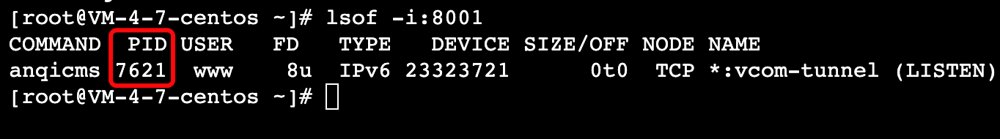

查找到被占用的PID后，通过 `kill -9 {PID}` 来结束它。
```bash
kill -9 7621
```
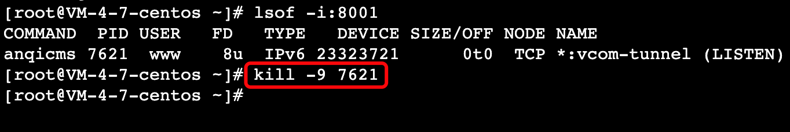

2. 伪静态规则设置不正确。