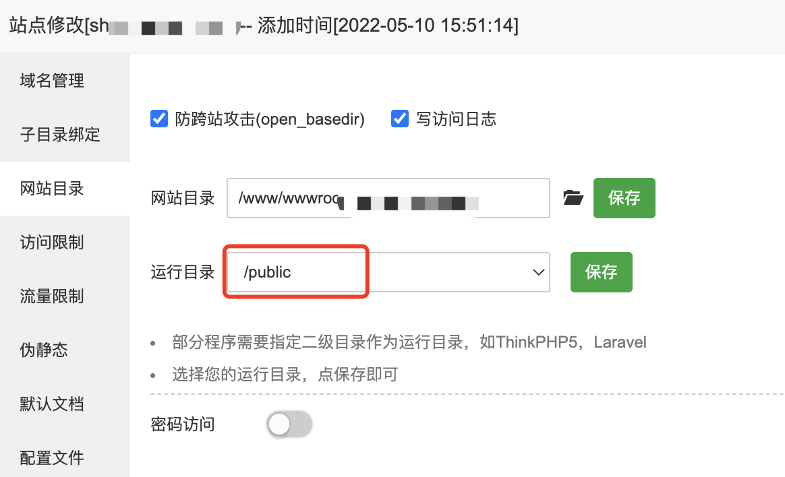
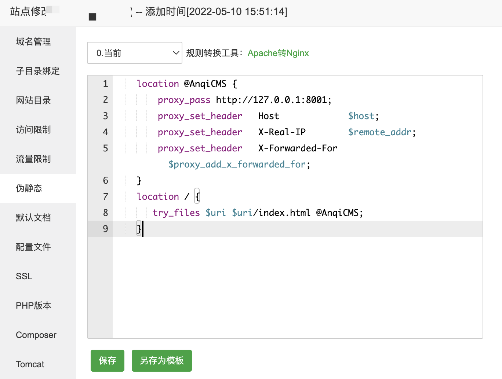
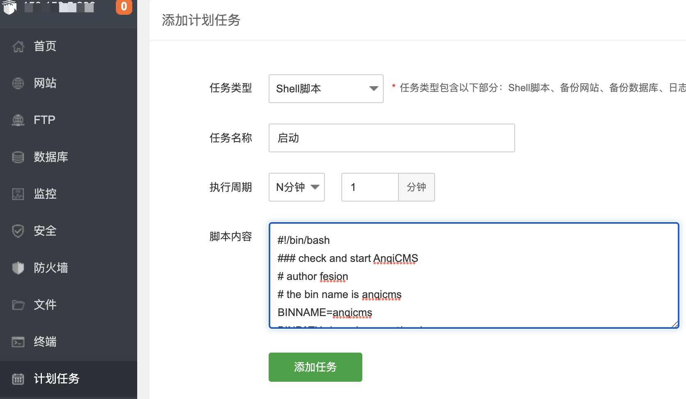
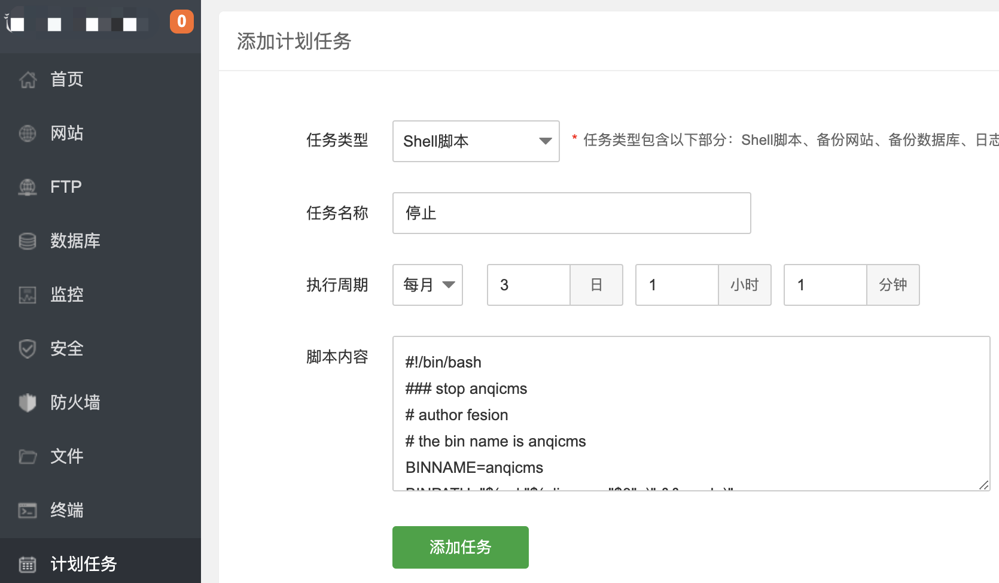
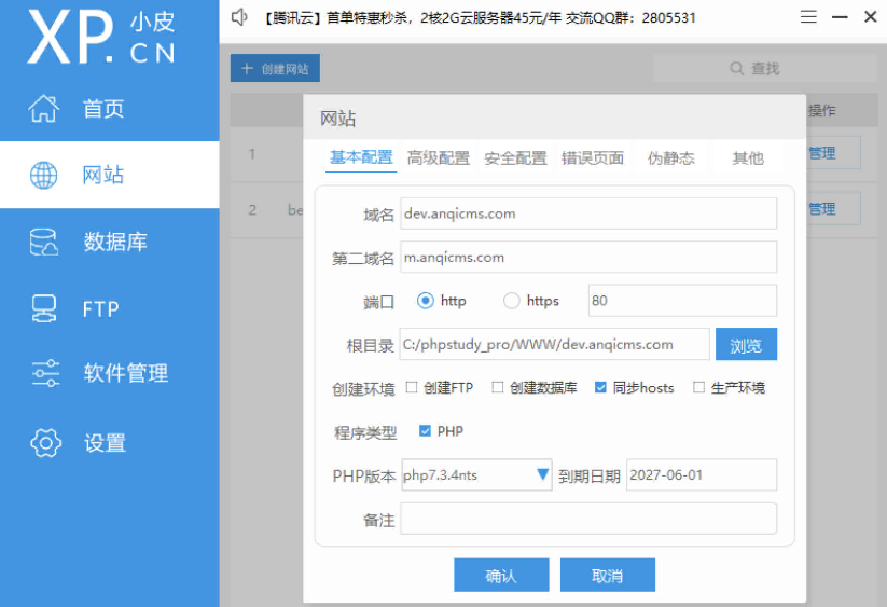
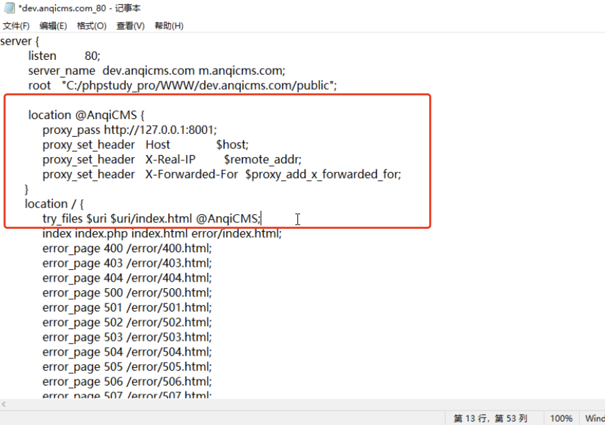
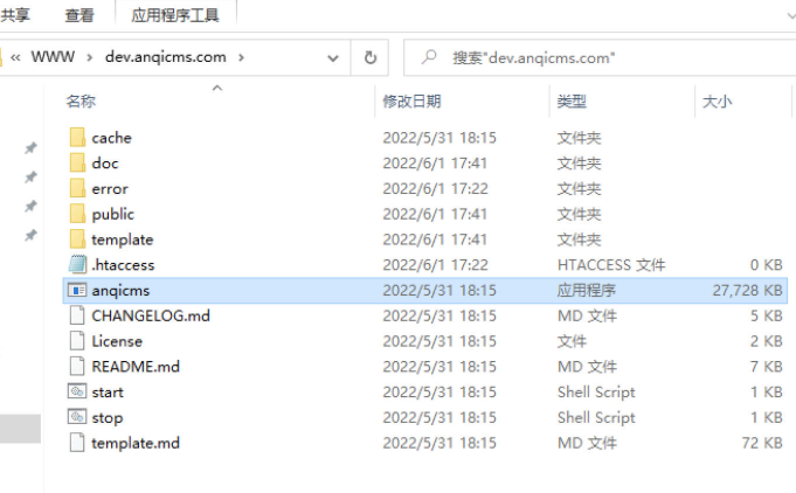
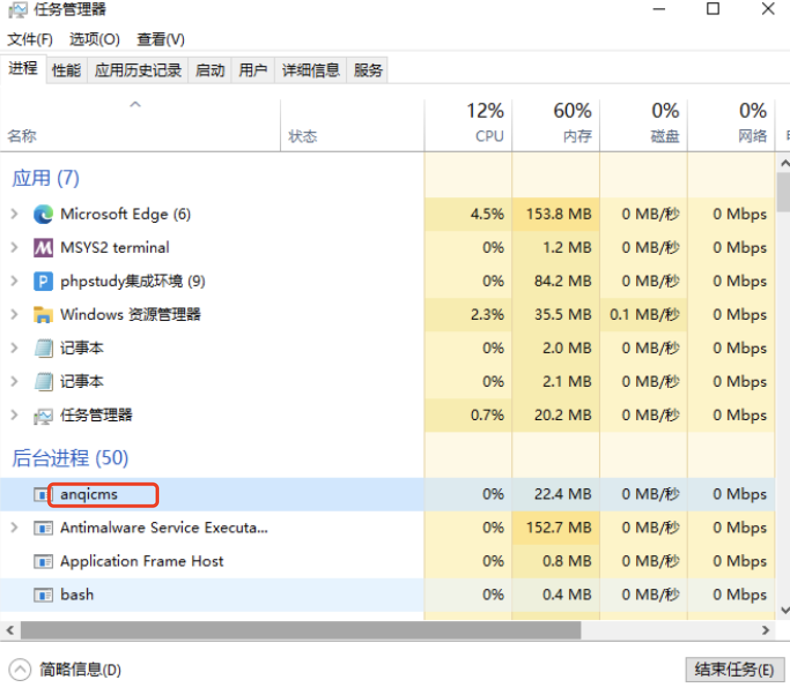

# 开始使用 AICMS

AI内容管理系统(AICMS)，是一款使用 GoLang 开发的企业站内容管理系统，它部署简单，软件安全，界面优雅，小巧，执行速度飞快，使用 AICMS 搭建的网站可以防止众多安全问题发生。

## 支持的系统

- 支持 Windows 7、Windows 8、Windows 10、Windows 11、Windows server 各个版本。 Windows XP 未测试
- 支持 Ubuntu、Centos、Red Hat、Debian 等 基于 X86 的 Linux 版本。

## AICMS 版本

最新稳定版：v2.1.0

你可以访问：https://www.kandaoni.com/AICMS 或 https://github.com/fesiong/goblog 来获得最新版本。

如果你安装了 AICMS，那么你也可以通过后台的检查更新功能，来保持你的网站程序为最新版。

## 安装 AICMS

### 在宝塔上安装（推荐）

- 创建站点

宝塔后台创建站点，并填写上你的域名，如 `www.aicms.com`、`m.aicms.com`。

- 调整nginx配置

在站点列表上，对应的站点菜单中，点击设置，在设置界面，点击站点目录标签，将运行目录一栏设置为 `/public` 并保存。



切换到伪静态标签，填写伪静态规则：

```conf
    location @AICMS {
        proxy_pass http://127.0.0.1:8001;
        proxy_set_header   Host             $host;
        proxy_set_header   X-Real-IP        $remote_addr;
        proxy_set_header   X-Forwarded-For  $proxy_add_x_forwarded_for;
    }
    location / {
       try_files $uri $uri/index.html @AICMS;
    }
```



保存，则配置好了nginx。

- 添加计划任务

在宝塔面板上，点击计划任务菜单，来到计划任务界面，分别添加 start.sh 和 stop.sh 的内容到计划任务中。

添加一个 每分钟执行的计划任务，名称为启动，内容为:

```bash
#!/bin/bash
### check and start AICMS
# author fesion
# the bin name is AICMS
BINNAME=AICMS
BINPATH=/www/wwwroot/AICMS

# check the pid if exists
exists=`ps -ef | grep '\<AICMS\>' |grep -v grep |wc -l`
echo "$(date +'%Y%m%d %H:%M:%S') $BINNAME PID check: $exists" >> $BINPATH/check.log
echo "PID $BINNAME check: $exists"
if [ $exists -eq 0 ]; then
    echo "$BINNAME NOT running"
    cd $BINPATH && nohup $BINPATH/$BINNAME >> $BINPATH/running.log 2>&1 &
fi
```



**注意：

- `BINPATH=/www/wwwroot/AICMS` 中的路径需要改成你的站点的实际真实路径。
- 如果你的可执行文件名不是 AICMS，则要替换成对应的名称。

再添加一个 1个月执行一次的计划任务，名称为停止，内容为：

```bash
#!/bin/bash
### stop AICMS
# author fesion
# the bin name is AICMS
BINNAME=AICMS
BINPATH="$( cd "$( dirname "$0"  )" && pwd  )"

# check the pid if exists
exists=`ps -ef | grep '\<AICMS\>' |grep -v grep |awk '{printf $2}'`
echo "$(date +'%Y%m%d %H:%M:%S') $BINNAME PID check: $exists" >> $BINPATH/check.log
echo "PID $BINNAME check: $exists"
if [ $exists -eq 0 ]; then
    echo "$BINNAME NOT running"
else
    echo "$BINNAME is running"
    kill -9 $exists
    echo "$BINNAME is stop"
fi
```



至此，站点配置结束。

点击执行名称为启动的计划任务，则完成启动。

### 在同一台服务器上安装多个 AICMS

往往会需要在同一台服务器上搭建多个网站的需求，使用 AICMS 搭建多套网站，则需要将的工作有：

- AICMS 的代码复制多份；
- 编辑更改根目录下的config.json ,将 port 端口 更改为一个新的端口，比如 8002，8003 每一份代码，都需要使用一个新的端口。
- 更改nginx伪静态配置中的关于端口 8001 的地方，改为新的端口。
- 并将 目录中的 AICMS 文件 重命名为一个新的不同的文件名，比如命名为域名的中间字母，如你做的站是 taobaoke.com ,则可命名为 taobaoke
- 分别再添加多一份 启动脚本 、 停止脚本 到计划任务中，启动脚本中的 BINPATH 路径改为新的目录路径，BINNAME 的 AICMS 和 `grep '\<AICMS\>'` 中的 AICMS 改为 taobaoke。

### 在PHPStudy(小皮)上安装

PHPStudy(小皮) 也一样，软件切换使用 PHP + MySQL + Nginx 套餐。

- 创建站点

在PHPStudy(小皮)软件界面上，创建站点台，并填写上你的域名，如 `dev.aicms.com`、`m.aicms.com`，记住站点根目录，如我的是：`C:/phpstudy_pro/WWW/dev.aicms.com`，在此基础上，加上 `/public`，根目录变成 `C:/phpstudy_pro/WWW/dev.aicms.com/public`。



点击确认完成站点的创建。


- 调整nginx配置

切换到PHPStudy(小皮)设置菜单，选择配置文件标签，再选择 `vhosts.conf` 标签，找到 `dev.aicms.com_80` 这个配置文件(根据你上面一步设置的域名定)，单击打开，在 `location / {` 这一行(大约第5行)，替换代码：

```conf
    location @AICMS {
        proxy_pass http://127.0.0.1:8001;
        proxy_set_header   Host             $host;
        proxy_set_header   X-Real-IP        $remote_addr;
        proxy_set_header   X-Forwarded-For  $proxy_add_x_forwarded_for;
    }
    location / {
       try_files $uri $uri/index.html @AICMS;
```



保存，则配置好了nginx, 并重启nginx。

- 放置文件

通过PHPStudy(小皮)软件的网站界面，点击管理，打开网站根目录，会来到 `C:/phpstudy_pro/WWW/dev.aicms.com/public`，返回目录上一级，将AICMS 软件的文件复制到这里：


至此，站点配置结束。

点击执行名称为启动的计划任务，则完成启动。



然后双击 AICMS.exe 运行。

运行的时候不会出现任何窗口，但不要惊慌，这时候，你打开一个浏览器，输入 `http://dev.aicms.com` 访问，就可以看到界面了。

- 退出 

Windows 上没有退出脚本，因此需要用到 Windows 的任务管理器，我们通过在任务栏单击右键选择任务管理器，切换到详细模式，在后台进程栏找到 AICMS 的进程，选择AICMS，并结束任务，就完成了退出。



### 在服务器上手动安装

我们以在 Centos 服务器上部署为例，介绍安装方法。

- 下载源码

下载地址： `https://www.kandaoni.com/download/`

选择 Linux 版本下载到服务器上，并命名为 AICMS.linux.tar.gz

解压 AICMS.linux.tar.gz, 并进入目录

```bash
tar -xzvf AICMS.linux.tar.gz
cd AICMS
# 查看当前目录
pwd
```

- 安装 Nginx 和 MySQL

如果你已经安装好，则跳过。推荐使用 `https://lnmp.org/` 来安装，可以省去折腾，安装方法参看 `https://lnmp.org/`。

- 配置 Nginx 站点

一般上，还需要配置nginx代理，来使用80端口或https端口。下面以站点跟目录为 `/data/wwwroot/AICMS`，域名 `www.aicms.com`、 `m.aicms.com` 配置为例：

我们需要将网站的运行目录，也就是nginx root 目录配置到站点目录下的public目录。

并设置反向代理，目标URL：`http://127.0.0.1:8001`

nginx代理代码如下：
```bash
    location @AICMS {
        proxy_pass http://127.0.0.1:8001;
        proxy_set_header   Host             $host;
        proxy_set_header   X-Real-IP        $remote_addr;
        proxy_set_header   X-Forwarded-For  $proxy_add_x_forwarded_for;
    }
    location / {
       try_files $uri $uri/index.html @AICMS;
    }
```

完整的nginx配置：
```conf
server
{
    listen       80;
    server_name www.aicms.com m.aicms.com;
    root /data/wwwroot/AICMS/public;

    location @AICMS {
        proxy_pass http://127.0.0.1:8001;
        proxy_set_header   Host             $host;
        proxy_set_header   X-Real-IP        $remote_addr;
        proxy_set_header   X-Forwarded-For  $proxy_add_x_forwarded_for;
    }
    location / {
       try_files $uri $uri/index.html @AICMS;
    }
    access_log access.log;
}
```

nginx设置完成，重启nginx来让配置生效。

- 计划任务监控运行

为了让网站持续运行，服务器重启后，网站依然运行，添加计划任务脚本，执行周期，每分钟执行一次，内容为：

```bash
crontab -e
# 在打开的编辑界面，增加一行
*/1 * * * * /data/wwwroot/AICMS/start.sh
# ws 保存并退出。
```

添加计划任务后，再顺手执行一次：

```bash
./start.sh
```

至此，你就可以在浏览器中打开绑定的域名访问了。

### 源码编译安装（不推荐）

如果我们提供的版本你无法使用，或者你对 golang 代码非常了解，甚至需要用 AICMS 来定制一些特色功能，那么你可以选择通过源码编译安装的方式来满足你的需求。

- AICMS 的编译需要依赖的软件

| 软件 | 版本|  
|:---------|:-------:|
| golang  |  1.13 (及以上) |
| mysql  |  5.6.35 (及以上) |

这里默认认为你已经安装了 GoLang 和 MySQL 软件。如果你没有安装这2款软件，那么你可以通过搜索引擎获取安装方法。

-  克隆代码

将`AICMS`的代码克隆到本地任意目录，并进入该目录操作  

```bash
git clone https://github.com/fesiong/goblog.git
# 进入 操作目录
cd goblog
```

- 编译 AICMS 源码

由于众所周知的原因，我们先需要设置代理，在终端执行这个代码：

```bash
go env -w GOPROXY=https://goproxy.cn,direct
```

接着执行下面的代码，编译代码是编译成可执行文件，测试运行可以一边测试一边修改。

```bash
go mod tidy
go mod vendor
```

测试运行 AICMS

```bash
go run kandaoni.com/AICMS/main
```

你可以通过上面一段代码来测试运行 AICMS，来检查代码的正确性。执行后，你可以在浏览器中输入测试地址访问： `http://127.0.0.1:8001` 

Windows 下编译 AICMS

```bash
go build -ldflags '-w -s -H=windowsgui' -o ./AICMS.exe kandaoni.com/AICMS/main
```

MacOS 下编译 AICMS

```bash
go build -ldflags '-w -s' -o ./AICMS kandaoni.com/AICMS/main
```

Linux 下编译 AICMS

你只需要在 AICMS 的根目录下执行 make 命令即可

```bash
make
```

它会在当前目录下生成一个release目录，并准备好了模板文件等，可以直接将里面的目录复制到生产环境使用。

## 运行 AICMS

- Windows 用户运行

请双击 AICMS.exe 来运行

初次访问，需要先初始化 AICMS，在初始化界面，输入 MySQL 信息，设置管理员账号、密码后，就可以正常访问网站的前台和后台了。

- Linux 用户运行

我们已经为生产环境准备了自动脚本，如需启动项目，则执行 `start.sh`, 如需停止，则执行 `stop.sh`。

```bash
# 启动项目
./start.sh
# 停止项目
./stop.sh
```

### 访问网页

运行后，在浏览器输入地址： `http://127.0.0.1:8001` 访问前端页面

### 访问后台管理

通过 `http://127.0.0.1:8001/system/` 访问后台页面。

如果你不是通过安装初始化博客的话，可能没有设置管理员账号，如果没有设置管理员账号，默认的管理员账号密码分别是：

账号：admin

密码：123456

## 示例网站 & 开发文档 & golang实战学习教程

[示例网站 - https://www.kandaoni.com/](https://www.kandaoni.com/)  

[实战学习教程](https://www.kandaoni.com/category/1)  

## 👥问题反馈    
遇到问题, 请在Github上开issue。  

也可以加我的微信：no_reg

扫码加入golang开发学习群


## License
The MIT License (MIT)

Copyright (c) 2019-NOW  Fesion <tpyzlxy@163.com>