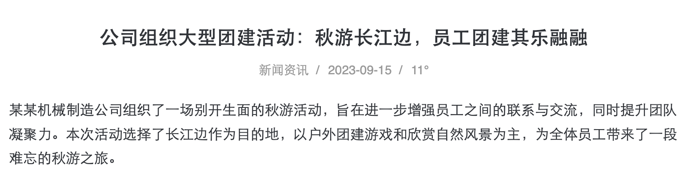
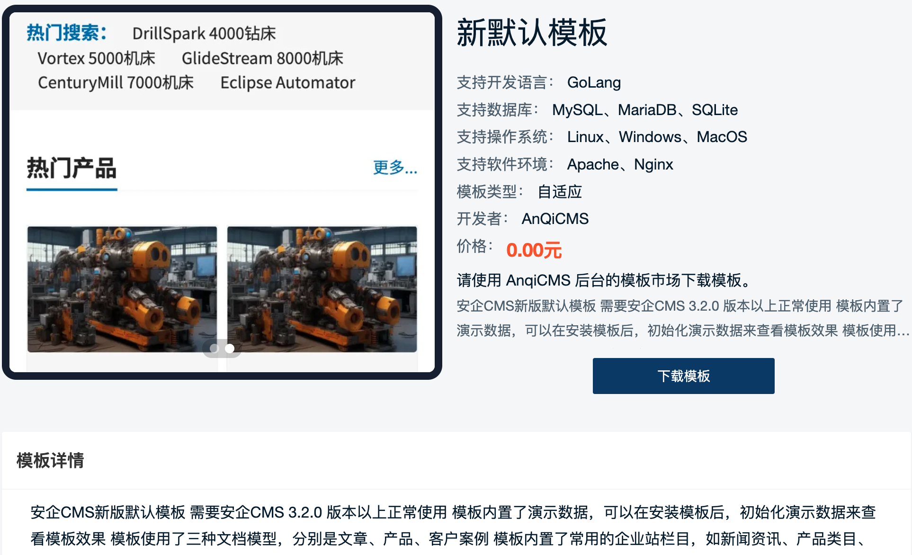

# 文档详情标签

说明：用于获取文档详情数据

使用方法：`` 变量名称不是必须的，设置了变量名称后，后续可以通过变量名称来调用，而不设置变量名称，则是直接输出结果。

archiveDetail 支持的参数有：

- 文档 ID `id`  
  `id` 不是必须的，默认会获取当前文档。如果需要指定文档，可以通过设置 id 来达到目的。
- 文档 URL 别名 `token`  
  `token` 不是必须的，默认会获取当前文档。如果需要指定文档，可以通过设置 id 或 token 来达到目的。
- 站点 ID `siteId`  
  `siteId` 一般不需要填写，如果你使用后台的多站点管理创建了多个站点，并且想调用其他站点的数据，则可以通过指定 `siteId` 来实现调用指定站点的数据。

文档详情页，也可以直接使用 `{{archive.文档字段}}` 来调用文档字段内容。

如果当前在组合文档 URL 下，URL 形式：`"/{module}/{id}/c-{combine}.html"` 如："/tour/1/c-2.html"，支持多个文档组合对比,最多支持 5 个，如有多个，则使用`隔开`，如：`"/cpu/11/c-12-13-14.html"`，则可以使用`combineIds` 或 `combineArchives` 来对数据进行数据的渲染对比。

### name 参数可用的字段有：

- 文档 ID `Id`
- 文档标题 `Title`
- 文档 SEO 标题 `SeoTitle`
- 文档链接 `Link`
- 文档关键词 `Keywords`
- 文档描述 `Description`
- 文档内容 `Content` 支持图片懒加载 需要使用标签 `lazy="data-src"`
- 文档内容的标题 `ContentTitles` 返回的是一个数组
- 文档模型 ID `ModuleId`
- 文档模型 ID `ParentId`
- 文档分类 ID `CategoryId`
- 文档规范链接 `CanonicalUrl`
- 文档的用户 ID `UserId`
- 价格 `Price`
- 库存 `Stock`
- 划线价格 `OriginPrice`
- 成本价 `CostPrice`
- 文档阅读等级 `ReadLevel`
- 文档的原文链接 `OriginUrl`
- 文档浏览量 `Views`
- 文档的 Flag 属性 `Flag`
- 文档封面图片 `Images`
- 文档封面首图 `Logo`
- 文档封面缩略图 `Thumb`
- 文档评论数量 `CommentCount`
- 文档分类 `Category`
- 文档添加时间 `CreatedTime` 时间戳，需要使用格式化时间戳为日期格式 `{{stampToDate(item.CreatedTime, "2006-01-02")}}`
- 文档更新时间 `UpdatedTime` 时间戳，需要使用格式化时间戳为日期格式 `{{stampToDate(item.UpdatedTime, "2006-01-02 15:04:05")}}`
- 文档标签
- 文档模型设置的其他字段参数
- `产品`视频地址 `VideoUrl`
- `产品`收藏数量 `FavoriteCount`
- `产品`评价数量 `ReviewCount`
- `产品`是否已收藏 `IsFavorite`
- `产品`是否需要物流 `NeedLogistics`
- `产品`是否免运费 `IsFreeShipping`
- `产品`销量 `SoldCount`
- `产品`SKU 模式 `OptionType`
- `产品`重量 `Weight`
- `产品`重量单位 `WeightUnit`
- `产品`是否支持批发 `IsWholesale`
- `产品`是否允许超卖 `AllowOversold`
- `产品`是否有有订单扩展字段 `HasOrderFields`
- `产品`订单扩展字段 `OrderFields`
- `产品`规格属性 `Options`
- `产品`规格列表 `Skus`
- `产品`当前选中的SKU `Sku`
- `产品`批发配置 `WholesaleRules`

### 文档 ID `Id`

标签用法：``

```twig
{# 默认用法，自动获取当前页面文档 #}
<div>分类标题：</div>
{# 获取指定文档id的文档字段 #}
<div>分类标题：</div>
{# 自定义字段名称 #}
<div>分类标题：{{archiveId}}</div>
<div>分类标题：{{archiveId}}</div>
```

### 文档标题 `Title`

标签用法：``

```twig
{# 默认用法，自动获取当前页面文档 #}
<div>文档标题：</div>
{# 获取指定文档id的文档字段 #}
<div>文档标题：</div>
{# 自定义字段名称 #}
<div>文档标题：{{archiveTitle}}</div>
<div>文档标题：{{archiveTitle}}</div>
```

### 文档链接 `Link`

标签用法：``

```twig
{# 默认用法，自动获取当前页面文档 #}
<div>文档链接：</div>
{# 获取指定文档id的文档字段 #}
<div>文档链接：</div>
{# 自定义字段名称 #}
<div>文档链接：{{archiveLink}}</div>
<div>文档链接：{{archiveLink}}</div>
```

### 文档描述 `Description`

标签用法：``

```twig
{# 默认用法，自动获取当前页面文档 #}
<div>文档描述：</div>
{# 获取指定文档id的文档字段 #}
<div>文档描述：</div>
{# 自定义字段名称 #}
<div>文档描述：{{archiveDescription}}</div>
<div>文档描述：{{archiveDescription}}</div>
```

### 文档内容 `Content`

标签用法：``
Content 字段支持图片的 lazyload 用法。需要用 `lazy="{定义的src名}"`来处理， 比如你使用的 lazyload 插件需要将 `` 改成 ``，则这么调用 `lazy="data-src"`

Content 字段在开启 Markdown 编辑器后，会自动对内容进行 Markdown 转 html 操作，关闭 Markdown 编辑器编辑器后，Content 内容不会自动对内容进行 Markdown 转 html 操作。但你可以手动指定是否进行转换，需要添加`render`参数。接受`false|true`两个值。`render=false`不进行 Markdown 转 html 操作，`render=true`进行转换。

```twig
{# 默认用法，自动获取当前页面文档 #}
<div>文档内容：</div>
{# 获取指定文档id的文档字段 #}
<div>文档内容：</div>
{# 自定义字段名称 #}
<div>文档内容：{{archiveContent|safe}}</div>
<div>文档内容：{{archiveContent|safe}}</div>
{# lazyload 替换 #}
<div>文档内容：{{archiveContent|safe}}</div>
{# markdown 转 html #}
<div>文档内容：{{archiveContent|safe}}</div>
{# 不进行markdown转换 #}
<div>文档内容：{{archiveContent|safe}}</div>
```

### 文档内容的标题 `ContentTitles`

标签用法：``

返回的是一个数组，内含的对象有：
`{Title: "标题", Tag: "标签", Level: 层级, Prefix: "前缀"}`

需要使用循环来调用：

```twig

<div>

    <div class="{{item.Tag}}" level="{{item.Level}}">{{item.Prefix}} {{item.Title}}</div>

</div>
```

### 文档分类 ID `CategoryId`

标签用法：``

```twig
{# 默认用法，自动获取当前页面文档 #}
<div>文档分类ID：</div>
{# 获取指定文档id的文档字段 #}
<div>文档分类ID：</div>
{# 自定义字段名称 #}
<div>文档分类ID：{{archiveCategoryId}}</div>
<div>文档分类ID：{{archiveCategoryId}}</div>
```

### 文档浏览量 `Views`

标签用法：``

```twig
{# 默认用法，自动获取当前页面文档 #}
<div>文档浏览量：</div>
{# 获取指定文档id的文档字段 #}
<div>文档浏览量：</div>
{# 自定义字段名称 #}
<div>文档浏览量：{{archiveViews}}</div>
<div>文档浏览量：{{archiveViews}}</div>
```

### 文档封面首图 `Logo`

标签用法：``

```twig
{# 默认用法，自动获取当前页面文档 #}
<div>文档封面首图：</div>
{# 获取指定文档id的文档字段 #}
<div>文档封面首图：</div>
{# 自定义字段名称 #}
<div>文档封面首图：</div>
<div>文档封面首图：</div>
```

### 文档封面缩略图 `Thumb`

标签用法：``

```twig
{# 默认用法，自动获取当前页面文档 #}
<div>文档封面缩略图：</div>
{# 获取指定文档id的文档字段 #}
<div>文档封面缩略图：</div>
{# 自定义字段名称 #}
<div>文档封面缩略图：</div>
<div>文档封面缩略图：</div>
```

### 文档封面图片 `Images`

Images 是一组图片，因此需要使用自定义方式来获取并循环输出

标签用法：``

```twig
{# 自定义字段名称 #}
<div>文档封面图片：
    
    
        
    
</div>
<div>文档封面图片：
    
    
        
    
</div>
```

### 文档添加时间 `CreatedTime`

CreatedTime 支持预格式化时间。用`2006-01-02`表示年-月-日，用`15:04::05`表示时分秒。如需要显示格式为 2021 年 06 月 30 日，可以写成`format="2006年01月02日"`，如需要显示格式为 2021/06/30 12:30，可以写成`format="2006/01/02 15:04"`。如果不设置 format，在默认用法下，它会自动被格式化为`2006-01-02`。

标签用法：``

```twig
{# 默认用法，自动获取当前页面文档 #}
<div>文档添加时间：</div>
<div>文档添加时间：</div>
{# 获取指定文档id的文档字段 #}
<div>文档添加时间：</div>
<div>文档添加时间：</div>
{# 自定义字段名称 #}
<div>文档添加时间：{{archiveCreatedTime}}</div>
<div>文档添加时间：{{archiveCreatedTime}}</div>
<div>文档添加时间：{{archiveCreatedTime}}</div>
<div>文档添加时间：{{archiveCreatedTime}}</div>
```

### 文档更新时间 `UpdatedTime`

UpdatedTime 支持预格式化时间。用`2006-01-02`表示年-月-日，用`15:04::05`表示时分秒。如需要显示格式为 2021 年 06 月 30 日，可以写成`format="2006年01月02日"`，如需要显示格式为 2021/06/30 12:30，可以写成`format="2006/01/02 15:04"`。如果不设置 format，在默认用法下，它会自动被格式化为`2006-01-02`。

标签用法：``

```twig
{# 默认用法，自动获取当前页面文档 #}
<div>文档更新时间：</div>
<div>文档更新时间：</div>
{# 获取指定文档id的文档字段 #}
<div>文档更新时间：</div>
<div>文档更新时间：</div>
{# 自定义字段名称 #}
<div>文档更新时间：{{archiveUpdatedTime}}</div>
<div>文档更新时间：{{archiveUpdatedTime}}</div>
<div>文档更新时间：{{archiveUpdatedTime}}</div>
<div>文档更新时间：{{archiveUpdatedTime}}</div>
```

### 文档分类 `Category`

```twig

<a href="{{ archiveCategory.Link }}">
    <span>分类ID：{{archiveCategory.Id}}</span>
    <span>分类名称：{{archiveCategory.Title}}</span>
    <span>分类链接：{{archiveCategory.Link}}</span>
    <span>分类描述：{{archiveCategory.Description}}</span>
    <span>上级分类ID：{{archiveCategory.ParentId}}</span>
</a>
<div>缩略图大图：</div>
<div>缩略图：</div>

{# 或者使用categoryDetail方式调用 #}
<span>分类ID：</span>
<span>分类名称：</span>
<span>分类链接：</span>
<span>分类描述：</span>
<span>上级分类ID：</span>
<div>缩略图大图：</div>
<div>缩略图：</div>
```

### 文档标签

```twig


<a href="{{item.Link}}">{{item.Title}}</a>


```

### 文档模型设置的其他字段参数

循环所有的字段

```twig

<div>
    
    <div>
        <span>{{item.Name}}：</span>
        <span>{{item.Value}}</span>
    </div>
    
</div>

```

如果你想只显示某个自定义字段的内容，如你自定义字段为 `author`，那么在模板中就可以这样调用：

```twig

```

自定义字段参数的使用，例如，你自定义了一个组图的字段，为 `arcimages`，并且想在前端展示它们，可以这么写：
```twig

<ul class="arc-images">
  
  <li></li>
  
</ul>
```

### 常见使用实例

1. 常见文章详情，在文档详情页面显示文档标题、文档分类、文档发布时间、文档标签、文档浏览量、文档详情。如图：
   

调用代码示例（代码不包含 css 样式控制）

```twig
<article>
    <h1></h1>
    <div>
        <a href=""></a>
        <span></span>
        
        
        <a href="{{item.Link}}">{{item.Title}}</a>
        
        
        <span>°</span>
    </div>
    <div>
        
        {{articleContent|safe}}
    </div>
</article>
```

2. 常见产品详情，在文档详情页面显示产品图片、产品名称、产品参数、产品简介、产品详情。如图：
   

调用代码示例（代码不包含 css 样式控制）

```twig
<article>
    <div>
        <div>
            
        </div>
        <div>
            <h1></h1>
            
            
            <div>
                <span>{{item.Name}}：</span>
                <span>{{item.Value}}</span>
            </div>
            
            
            <div></div>
            <div>
                <a href="tel:" rel="nofollow">电话联系：</a>
            </div>
        </div>
    </div>
    <div>
        <div>产品详情</div>
        <div>
            
            {{articleContent|safe}}
        </div>
    </div>
</article>
```
