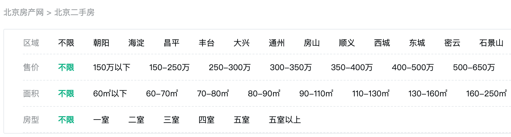

# 文档参数筛选标签

> 文档参数筛选仅可用着文档首页或文档分类的模板上，结合文档分页列表使用。

说明：用于做根据文档各项参数进行列表组合筛选的筛选条件，如做房产网站的时候，可以根据房屋类型为住宅、商铺、商住两用 筛选，同时可以附加根据房屋大小为单间、一室一厅、两室两厅、三室两厅等筛选，这种情况下就可以用到文档参数筛选功能。

使用方法：`` 如将变量定义为 filters `...`

### archiveFilters 支持的参数有：

- 模型 ID `moduleId`  
  `moduleId` 可以获取指定模型的参数筛选，如 `moduleId="1"` 获取文章模型的参数筛选。
- 全部关键词 `allText`  
  `allText` 设置全部关键词是文字内容，如“全部”，如果不想显示，则设置 `allText=false`。
- 是否显示分类筛选 `showCategory`
  `showCategory` 设置是否显示分类筛选，默认为 `false`
- 分类筛选中上级分类ID `parentId`
  `parentId` 默认为 `0`，表示获取所有分类，如果指定了 `parentId`，则只获取指定分类的子分类，`parentId="parent"`表示获取兄弟分类。 `showCategory=true` 的时候才生效。
- 站点 ID `siteId`  
  `siteId` 一般不需要填写，如果你使用后台的多站点管理创建了多个站点，并且想调用其他站点的数据，则可以通过指定 `siteId` 来实现调用指定站点的数据。

filters 变量为一个数组对象，需要通过 `for` 循环来输出。for item 的对象结构是：

- 参数名称 `Name`
- 参数字段名 `FieldName`
- 该参数的可选值 `Items`
  `Items` 是一个数组对象，需要通过 `for` 循环来输出。 for val 的对象结构是：
  - 筛选值 `Label`
  - 筛选值链接 `Link`
  - 是否选中 `IsCurrent`

### 代码示例

```twig
{# 参数筛选代码 #}
<div>
    <div>参数筛选：</div>
    
        
        <ul>
            <li>{{item.Name}}: </li>
            
            <li class="active"><a href="{{val.Link}}">{{val.Label}}</a></li>
            
        </ul>
    
    
</div>

{# 文档列表代码 #}
<div>

    
    <li>
        <a href="{{item.Link}}">
            <h5>{{item.Title}}</h5>
            <div>{{item.Description}}</div>
            <div>
                <span></span>
                <span>{{stampToDate(item.CreatedTime, "2006-01-02")}}</span>
                <span>{{item.Views}} 阅读</span>
            </div>
        </a>
        
        <a href="{{item.Link}}">
            
        </a>
        
    </li>
    
    <li>
        该列表没有任何内容
    </li>
    


    {# 分页代码 #}
    <div>
        
            {# 首页 #}
            <a class="active" href="{{pages.FirstPage.Link}}">{{pages.FirstPage.Name}}</a>
            {# 上一页 #}
            
            <a href="{{pages.PrevPage.Link}}">{{pages.PrevPage.Name}}</a>
            
            {# 中间多页 #}
            
            <a class="active" href="{{item.Link}}">{{item.Name}}</a>
            
            {# 下一页 #}
            
            <a href="{{pages.NextPage.Link}}">{{pages.NextPage.Name}}</a>
            
            {# 尾页 #}
            <a class="active" href="{{pages.LastPage.Link}}">{{pages.LastPage.Name}}</a>
        
    </div>
</div>
```

### 常见使用实例

在一个房产文档列表中，可以通过各种筛选条件，来显示文档，如图：



调用代码示例（代码不包含 css 样式控制）

```twig
<div>
    <div>房产筛选：</div>
    
        
        <ul>
            <li>{{item.Name}}: </li>
            
            <li class="active"><a href="{{val.Link}}">{{val.Label}}</a></li>
            
        </ul>
    
    
</div>
```
