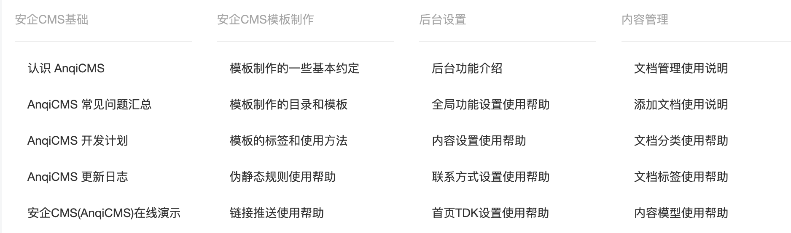
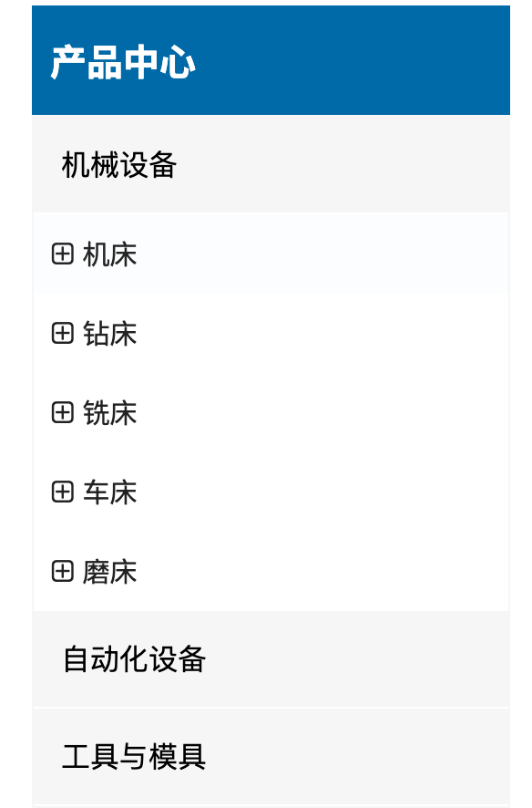

# 文档列表标签

说明：用于获取文档常规列表、相关文档列表、文档分页列表

使用方法：`` 如将变量定义为 archives `...`

### archiveList 支持的参数有：

- 模型 ID `moduleId`  
  `moduleId` 可以获取指定文档模型的文档列表如 `moduleId="1"` 获取文章模型的文档列表。
- 分类 ID `categoryId`  
  `categoryId` 可以获取指定分类的文档列表如 `categoryId="1"` 获取文档分类 ID 为 1 的文档列表。多个分类 ID 可用,隔开，如 `categoryId="1,2,3"`。  
  > 如果未指定 `categoryId` 它会尝试读取当前页面分类的分类 ID，因此如果希望它不自动读取当前分类 ID，则可以通过 `categoryId="0"` 来指定不自动读取。
- 排除的分类 ID `excludeCategoryId`  
  `excludeCategoryId` 可以排除指定分类的文档如 `excludeCategoryId="1"` 排除文档分类 ID 为 1 的文档。多个分类 ID 可用,隔开
- 作者 ID `userId`  
  `userId` 可以获取指定用户 ID 发布的文档，如 `userId="1"`获取用户 ID 为 1 的用户发布的文档。
- 上级文档 ID `parentId`  
  `parentId` 可以获取指定上级的文档，如 `parentId="1"`获取上级 ID 为 1 的文档。
- 推荐属性 `flag`  
  `flag` 支持的属性值有 头条[h]、推荐[c]、幻灯[f]、特荐[a]、滚动[s]、加粗[h]、图片[p]、跳转[j]。如要显示 flag 属性为推荐的，则标签为 `flag="c"`
- 排除的推荐属性 `excludeFlag`  
  `excludeFlag` 支持排除的属性值有 头条[h]、推荐[c]、幻灯[f]、特荐[a]、滚动[s]、加粗[h]、图片[p]、跳转[j]。如要项列表不显示指定的 flag 属性的文档，则标签为 `excludeFlag="c"`
- 是否列出文档的 flag `showFlag`  
  `showFlag` 支持的值有 `true|false`，默认为 `false`。如果需要在文档列表中显示文档的 flag 标签，则设置为 `showFlag=true`
- 是否显示内容 `showContent`
  `showContent` 默认值为 `false`，如果设置为 `true`，则列表中会显示文档内容。
- 是否显示文档自定义字段 `showExtra`
  需要指定分类或指定模型ID，才能显示文档自定义字段。 默认值为 `false`。如果希望在文档列表中显示文档自定义字段，则设置为 `showExtra=true`。
- (产品)是否显示产品规格属性 `showOptions`
  该参数在产品列表中方可生效，可以显示产品规格属性，包括属性值。默认值为 `false`。如果希望在文档列表中显示产品规格属性，则设置为 `showOptions=true`。
- (产品)是否显示产品规格 `showSkus`
  该参数在产品列表中方可生效，可以显示产品规格列表。默认值为 `false`。如果希望在文档列表中显示产品规格，则设置为 `showSkus=true`。
- (产品)是否显示产品批发配置 `showWholesaleRules`
  该参数在产品列表中方可生效，可以显示产品批发配置。默认值为 `false`。如果希望在文档列表中显示产品批发配置，则设置为 `showWholesaleRules=true`。
- 是否显示子分类内容 `child`  
  `child` 支持的属性值有 `false|true`，默认 true。如只想显示属于当前分类的文档，而不包括子分类的文档，则需指定 `child=false`
- 排序方式 `order`  
  `order` 可以指定文档显示的排序规则，支持依据 最新文档排序 `order="id desc"`、浏览量最多文档排序 `order="views desc"`、按后台自定义排序 `order="sort desc"`，默认按照自定义排序，可以不用填。
- 显示数量 `limit`  
  `limit` 可以指定显示数量，按多少数量来分页，比如`limit="10"`则只会显示 10 条，`limit` 在不是分页列表的时候，支持`offset`模式，也就是 `,`分隔模式，如想从第 2 条开始，获取 10 条数据，可以设置成 `limit="2,10"`。
- 列表类型 `type`  
  `type` 支持按 page、list、related 方式列出。默认值为 list，`type="list"` 时，只会显示 指定的 limit 指定的数量，如果`type="page"` 后续可用 `pagination` 来组织分页显示 ``。`type` 的值为 related 的情况下，支持 like 参数。 like="keywords|relation"，默认不需要 like 参数，它自动获取最靠近当前文档的其他文档。如果指定了 like="keywords"，则会根据文档第一个关键词来获取相关的文档。如果指定了 like="relation"，则只会展示后台文档编辑界面设置的相关文档。
- 搜索关键词 `q`  
  `q` 可以指定搜索内容，如果需要搜索内容，可以通过参数`q`来展示指定包含关键词的标题搜索内容如 `q="seo"` 呈现结果将只显示标题包含`seo`关键词的列表。也可以不指定，如果 url 中存在 `q=关键词` 的 query 参数，则在分页列表中会自动读取 `q` 关键词内容并用于搜索。
- 筛选参数 `自定义`  
  在文档额外自动配置中，配置了可筛选的字段，可以通过将这些字段附加到 url 的 query 参数上，来完成对文档进行参数是筛选。如你的文档中设置了筛选自动为`sex,默认值有 男，女，保密`，则你可以通过 url 的 query 参数`sex=男` 来搜索文档 sex 字段是男的文档内容。也可以通过在标签中添加自定义筛选参数,来获取指定筛选条件的内容，如 ``
- 站点 ID `siteId`  
  `siteId` 一般不需要填写，如果你使用后台的多站点管理创建了多个站点，并且想调用其他站点的数据，则可以通过指定 `siteId` 来实现调用指定站点的数据。
- 组合文档 ID `combineId`  
  `combineId` 这是一个特殊字段，用于在列表中附加一个文档，比如一篇文档是“北京”，组合的文档是“上海”，你可以使用`{{item.Title}}到{{combine.Title}}的旅游线路`，可以实现“从北京到上海的旅游线路”的标题生成，并且新链接也会加上组合，如北京的 ID 是 1，上海的 ID 是 2，则 URL 可能是："/tour/1/c-2.html"。
- 前置组合文档 ID `combineFromId`  
  `combineFromId` 这是一个特殊字段，用于在列表中附加一个文档，比如一篇文档是“北京”，前置组合的文档是“上海”，你可以使用`{{combine.Title}}到{{item.Title}}的旅游线路`，可以实现“从上海到北京的旅游线路”的标题生成，并且新链接也会加上组合，如北京的 ID 是 1，上海的 ID 是 2，则 URL 可能是："/tour/2/c-1.html"。和`combineId`顺序相反。

使用了 `combineId` 或 `combineFromId` 后，列表中可用 `{{combine.文档字段}}` 来调用组合文档的字段内容。在组合文档 URL 下，有 `{{combineArchive.文档字段}}` 可用于调用组合文档的字段内容。

archives 是一个数组对象，因此需要使用 `for` 循环来输出

### item 为 for 循环体内的变量，可用的字段有：

- 文档 ID `Id`
- 文档标题 `Title`
- 文档 SEO 标题 `SeoTitle`
- 文档链接 `Link`
- 文档关键词 `Keywords`
- 文档描述 `Description`
- 文档模型 ID `ModuleId`
- 文档分类 ID `CategoryId`
- 文档规范链接 `CanonicalUrl`
- 文档的用户 ID `UserId`
- 上级 ID `ParentId`
- 价格 `Price`
- 库存 `Stock`
- 文档阅读等级 `ReadLevel`
- 文档的原文链接 `OriginUrl`
- 文档浏览量 `Views`
- 文档封面图片 `Images`
- 文档封面首图 `Logo`
- 文档封面缩略图 `Thumb`
- 文档评论数量 `CommentCount`
- 文档添加时间 `CreatedTime` 时间戳，需要使用格式化时间戳为日期格式 `{{stampToDate(item.CreatedTime, "2006-01-02")}}`
- 文档更新时间 `UpdatedTime` 时间戳，需要使用格式化时间戳为日期格式 `{{stampToDate(item.UpdatedTime, "2006-01-02 15:04:05")}}`
- 文档的 Flag `Flag` 显示文档的 flag 属性，需要在查询列表时，指定 `showFlag=true`
- 文档标签
- 文档模型设置的其他字段参数
- `产品`视频地址 `VideoUrl`
- `产品`收藏数量 `FavoriteCount`
- `产品`评价数量 `ReviewCount`
- `产品`是否已收藏 `IsFavorite`
- `产品`是否需要物流 `NeedLogistics`
- `产品`是否免运费 `IsFreeShipping`
- `产品`销量 `SoldCount`
- `产品`SKU 模式 `OptionType`
- `产品`重量 `Weight`
- `产品`重量单位 `WeightUnit`
- `产品`是否支持批发 `IsWholesale`
- `产品`是否允许超卖 `AllowOversold`
- `产品`是否有有订单扩展字段 `HasOrderFields`
- `产品`订单扩展字段 `OrderFields`
- `产品`规格属性 `Options` 需要使用 `showOptions=true`
- `产品`规格列表 `Skus` 需要使用 `showSkus=true`
- `产品`批发配置 `WholesaleRules` 需要使用 `showWholesaleRules=true`

### 代码示例

```twig
{# list 列表展示 #}
<div>

    
    <li>
        {#  如需判断当前是否是循环中的第一条，可以这么写： #}
        这是第一条
        {# 比如需要给第一条添加额外class="active"，可以这么写： #}
        <a class="active" href="{{item.Link}}">{{item.Title}}</a>

        <span>当前第{{ forloop.Counter }}篇，剩余{{ forloop.Revcounter}}篇</span>
        <span>文档ID：{{item.Id}}</span>
        <span>上级ID：{{item.ParentId}}</span>
        <span>文档标题：{{item.Title}}</span>
        <span>文档链接：{{item.Link}}</span>
        <span>文档关键词：{{item.Keywords}}</span>
        <span>文档描述：{{item.Description}}</span>
        <span>文档分类ID：{{item.CategoryId}}</span>
        <span>文档浏览量：{{item.Views}}</span>
        <span>文档的Flag属性：{{item.Flag}}</span>
        <span>文档发布日期：{{stampToDate(item.CreatedTime, "2006-01-02")}}</span>
        <span>文档发布月日：{{stampToDate(item.CreatedTime, "01-02")}}</span>
        <span>文档发布时间：{{stampToDate(item.CreatedTime, "15:04:05")}}</span>
        <span>文档发布时分：{{stampToDate(item.CreatedTime, "15:04")}}</span>
        <span>文档发布日期时间：{{stampToDate(item.CreatedTime, "2006-01-02 15:04:05")}}</span>
        <div>封面首图</div>
        <div>封面缩略图</div>
        封面组图图片
        <ul>
        
        <li>
            
        </li>
        
        </ul>

        文档标签：
        
        
        <a href="{{item.Link}}">{{item.Title}}</a>
        
        

        文档额外字段
        
        <div>
            
            <div>
                <span>{{item.Name}}：</span>
                <span>{{item.Value}}</span>
            </div>
            
        </div>
        
    </li>
    
    <li>
        该列表没有任何内容
    </li>
    

</div>
```

### 列表展示文档

```twig
{# list 列表展示 #}
<div>

    
    <li>
        <a href="{{item.Link}}">
            <h5>{{item.Title}}</h5>
            <div>{{item.Description}}</div>
            <div>
                <span></span>
                <span>{{stampToDate(item.CreatedTime, "2006-01-02")}}</span>
                <span>{{item.Views}} 阅读</span>
            </div>
        </a>
        
        <a href="{{item.Link}}">
            
        </a>
        
    </li>
    
    <li>
        该列表没有任何内容
    </li>
    

</div>
```

### 获取当前文档的下级文档

通过 parentId 获取下级文档，在文档详情页面可用

```twig
{# 获取当前文档的下级文档 #}
{# 先获取当前文档的ID #}

<div>
{# 再通过 指定 parentId 获取下级文档 #}

    
    <li>
        <a href="{{item.Link}}">
            <h5>{{item.Title}}</h5>
            <div>{{item.Description}}</div>
            <div>
                <span></span>
                <span>{{stampToDate(item.CreatedTime, "2006-01-02")}}</span>
                <span>{{item.Views}} 阅读</span>
            </div>
        </a>
        
        <a href="{{item.Link}}">
            
        </a>
        
    </li>
    
    <li>
        该列表没有任何内容
    </li>
    

</div>
```

### 展示相关文档

```twig
{# related 相关文档列表展示 #}
<div>

    
    <li>
        <a href="{{item.Link}}">
            <h5>{{item.Title}}</h5>
            <div>{{item.Description}}</div>
            <div>
                <span></span>
                <span>{{stampToDate(item.CreatedTime, "2006-01-02")}}</span>
                <span>{{item.Views}} 阅读</span>
            </div>
        </a>
        
        <a href="{{item.Link}}">
            
        </a>
        
    </li>
    
    <li>
        该列表没有任何内容
    </li>
    

</div>
```

### 分页展示文档

```twig
{# page 分页列表展示 #}
<div>

    
    <li>
        <a href="{{item.Link}}">
            <h5>{{item.Title}}</h5>
            <div>{{item.Description}}</div>
            <div>
                <span></span>
                <span>{{stampToDate(item.CreatedTime, "2006-01-02")}}</span>
                <span>{{item.Views}} 阅读</span>
            </div>
        </a>
        
        <a href="{{item.Link}}">
            
        </a>
        
    </li>
    
    <li>
        该列表没有任何内容
    </li>
    


    {# 分页代码 #}
    <div >
        
            {# 首页 #}
            <a class="active" href="{{pages.FirstPage.Link}}">{{pages.FirstPage.Name}}</a>
            {# 上一页 #}
            
            <a href="{{pages.PrevPage.Link}}">{{pages.PrevPage.Name}}</a>
            
            {# 中间多页 #}
            
            <a class="active" href="{{item.Link}}">{{item.Name}}</a>
            
            {# 下一页 #}
            
            <a href="{{pages.NextPage.Link}}">{{pages.NextPage.Name}}</a>
            
            {# 尾页 #}
            <a class="active" href="{{pages.LastPage.Link}}">{{pages.LastPage.Name}}</a>
        
    </div>
</div>
```

### 搜索文档分页展示

搜索接收默认路径为： `/search`

搜索表单示例代码：

```twig
<form method="get" action="/search">
    <div>
        <input type="text" name="q" placeholder="请输入搜索关键词" value="{{urlParams.q}}">
        <button type="submit">搜索</button>
    </div>
</form>
```

注意：这里的 q 可以不指定，而是通过浏览器的 url 的 query 参数来动态获取 如：`https://www.kandaoni.com/search?q=seo`

```twig
{# page 搜索指定关键词分页列表展示 #}
<div>

    
    <li>
        <a href="{{item.Link}}">
            <h5>{{item.Title}}</h5>
            <div>{{item.Description}}</div>
            <div>
                <span></span>
                <span>{{stampToDate(item.CreatedTime, "2006-01-02")}}</span>
                <span>{{item.Views}} 阅读</span>
            </div>
        </a>
        
        <a href="{{item.Link}}">
            
        </a>
        
    </li>
    
    <li>
        该列表没有任何内容
    </li>
    


    {# 分页代码 #}
    <div>
        
            {# 首页 #}
            <a class="active" href="{{pages.FirstPage.Link}}">{{pages.FirstPage.Name}}</a>
            {# 上一页 #}
            
            <a href="{{pages.PrevPage.Link}}">{{pages.PrevPage.Name}}</a>
            
            {# 中间多页 #}
            
            <a class="active" href="{{item.Link}}">{{item.Name}}</a>
            
            {# 下一页 #}
            
            <a href="{{pages.NextPage.Link}}">{{pages.NextPage.Name}}</a>
            
            {# 尾页 #}
            <a class="active" href="{{pages.LastPage.Link}}">{{pages.LastPage.Name}}</a>
        
    </div>
</div>
```

### 常见使用实例

1. 在循环多个分类中显示分类下的文档。如图：



调用代码示例（代码不包含 css 样式控制）

```twig

<div>
    
    <div>
        <h3><a href="{{ item.Link }}">{{item.Title}}</a></h3>
        <ul>
            
            
            <li>
                <a href="{{archive.Link}}">
                    <h5>{{archive.Title}}</h5>
                    <div>{{archive.Description}}</div>
                    <div>
                        <span>{{stampToDate(archive.CreatedTime, "2006-01-02")}}</span>
                        <span>{{archive.Views}} 阅读</span>
                    </div>
                </a>
                
                <a href="{{archive.Link}}">
                    
                </a>
                
            </li>
            
            <li>
                该列表没有任何内容
            </li>
            
        
        </ul>
    </div>
    
</div>

```

2. 在循环多个分类中显示分类的下级分类，如果没有下级分类，则显示分类的文档。如图：



调用代码示例（代码不包含 css 样式控制）

```twig
<div>
    
    
    <a href="{{item.Link}}">{{item.Title}}</a>
    <ul class="ind-pro-nav-ul">
        
            
            
            <li><a href="{{inner.Link}}" title="">{{inner.Title}}</a></li>
            
            
        
            
            
            <li><a href="{{inner.Link}}" title="">{{inner.Title}}</a></li>
            
            
        
    </ul>
    
    
</div>
```
