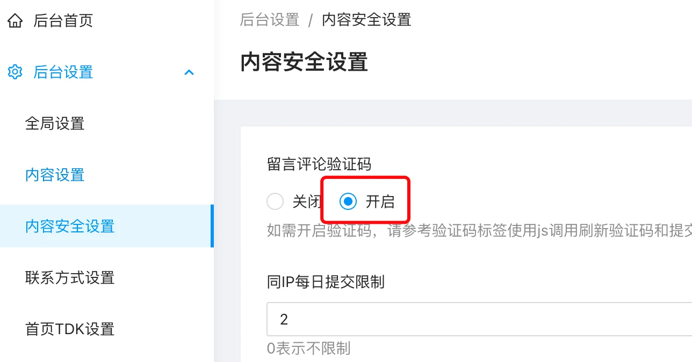

# 留言验证码使用标签

在网站留言、评论中需要开启验证码的时候，可以按如下操作来处理：

1. 后台开启留言评论验证码功能



2. 在留言或评论的表单中，增加验证码字段和代码：

```twig
<div style="display: flex; clear: both">
  <input type="hidden" name="captcha_id" id="captcha_id">
  <input type="text" name="captcha" required placeholder="请填写验证码" class="layui-input" style="flex: 1">
  
  <script>
    document.getElementById('get-captcha').addEventListener("click", function (e) {
      fetch('/api/captcha')
              .then(response => {
                return response.json()
              })
              .then(res => {
                document.getElementById('captcha_id').setAttribute("value", res.data.captcha_id)
                document.getElementById('get-captcha').setAttribute("src", res.data.captcha)
              }).catch(err =>{console.log(err)})
    });
    document.getElementById('get-captcha').click();
  </script>
</div>
```

如果你的网站使用了 jQuery，则<script></script>部分可以使用 jquery 的写法：

```twig
<script>
  // jquery 调用方式
  $('#get-captcha').on("click", function (e) {
    $.get('/api/captcha', function(res) {
      $('#captcha_id').attr("value", res.data.captcha_id)
      $('#get-captcha').attr("src", res.data.captcha)
    }, 'json')
  })
  $('#get-captcha').click();
</script>
```

至此，你的留言或评论就开启了验证码验证功能，用户留言就需要输入验证码验证了。
