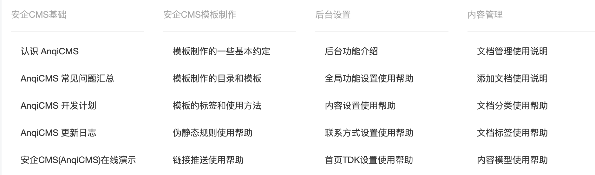
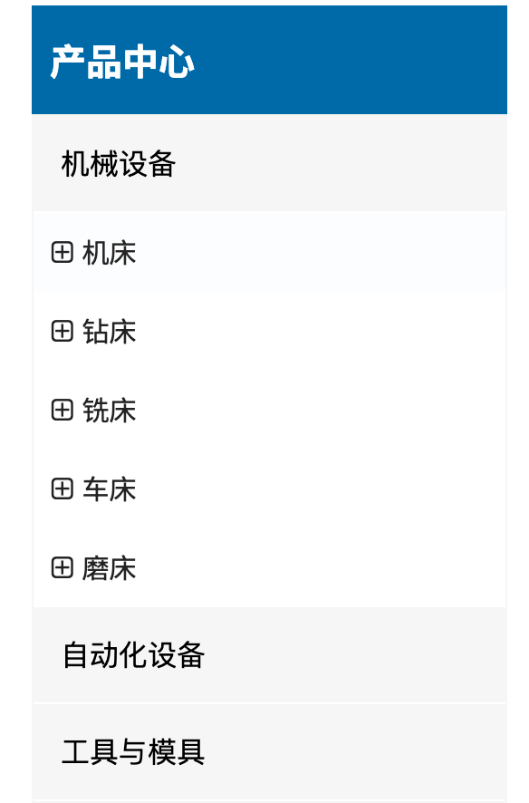

# 分类列表标签

说明：用于获取文章、产品分类列表

使用方法：`` 如将变量定义为 categories `...`

### categoryList 支持的参数有：

- 模型 ID `moduleId`  
  `moduleId` 可以获取指定文档模型的分类列表如 `moduleId="1"` 获取文章模型的分类列表。
- 上级分类 `parentId`  
  `parentId` 表示上级分类，可以获取指定上级分类下的子分类，`parentId="parent"` 表示上级分类为当前分类的上级分类，表示获取当前分类的兄弟分类。parentId="0"的时候，获取顶级分类。当要获取顶级分类的时候，必须指定模型 ID `moduleId`
- 获取全部分类 `all`  
  `all` 可以获取指定所有分类列表，如 `all=true` 获取所有分类，如果同时指定了`moduleId`，则获取指定模型下的所有分类。
- 显示数量 `limit`  
  `limit` 可以指定显示数量，比如`limit="10"`则只会显示 10 条，`limit` 支持`offset`模式，也就是 `,`分隔模式，如想从第 2 条开始，获取 10 条数据，可以设置成 `limit="2,10"`。
- 站点 ID `siteId`  
  `siteId` 一般不需要填写，如果你使用后台的多站点管理创建了多个站点，并且想调用其他站点的数据，则可以通过指定 `siteId` 来实现调用指定站点的数据。

如果想获取当前分类的下级分类，则不需要指定 `parentId`。如果想获取当前分类的兄弟分类，则指定 `parentId="parent"`，仅当在文档列表的时候有效。

categories 是一个数组对象，因此需要使用 `for` 循环来输出

### item 为 for 循环体内的变量，可用的字段有：

- 分类 ID `Id`
- 分类标题 `Title`
- 分类链接 `Link`
- 分类描述 `Description`
- 分类内容 `Content`
- 上级分类 ID `ParentId`
- 分类缩略图大图 `Logo`
- 分类缩略图 `Thumb`
- 下级分类前缀 `Spacer`
- 是否有下级分类 `HasChildren`
- 是否当前链接 `IsCurrent`
- 分类的文档数量 `ArchiveCount`

### 代码示例

```twig

<ul>
    
    <li>
        {#  如需判断当前是否是循环中的第一条，可以这么写： #}
        这是第一条
        {# 比如需要给第一条添加额外class="active"，可以这么写： #}
        <a class="active" href="{{item.Link}}">{{item.Title}}</a>

        <a href="{{ item.Link }}">{{item.Spacer|safe}}{{item.Title}}</a>
        <a href="{{ item.Link }}">
            <span>当前第{{ forloop.Counter }}个，剩余{{ forloop.Revcounter}}ge</span>
            <span>分类ID：{{item.Id}}</span>
            <span>分类名称：{{item.Title}}</span>
            <span>分类链接：{{item.Link}}</span>
            <span>分类描述：{{item.Description}}</span>
            <span>分类内容：{{item.Content|safe}}</span>
            <span>上级分类ID：{{item.ParentId}}</span>
            <span>下级分类前缀：{{item.Spacer|safe}}</span>
            <span>是否有下级分类：{{item.HasChildren}}</span>
        </a>
        <div>缩略图大图：</div>
        <div>缩略图：</div>
    </li>
    
</ul>

```

### 多级分类嵌套调用

```twig

{#一级分类#}
<ul>
    
    <li>
        <a href="{{ item.Link }}">{{item.Title}}</a>
        <div>
            
            {#二级分类#}
            <ul>
                
                <li>
                    <a href="{{ inner1.Link }}">{{inner1.Title}}</a>
                    <div>
                        
                        {#三级分类#}
                        <ul>
                            
                            <li>
                                <a href="{{ inner2.Link }}">{{inner2.Title}}</a>
                            </li>
                            
                        </ul>
                        
                    </div>
                </li>
                
            </ul>
            
        </div>
    </li>
    
</ul>

```

### 常见使用实例

1. 在循环多个分类中显示分类下的文档。如图：



调用代码示例（代码不包含 css 样式控制）

```twig

<div>
    
    <div>
        <h3><a href="{{ item.Link }}">{{item.Title}}</a></h3>
        <ul>
            
            
            <li>
                <a href="{{archive.Link}}">
                    <h5>{{archive.Title}}</h5>
                    <div>{{archive.Description}}</div>
                    <div>
                        <span>{{stampToDate(archive.CreatedTime, "2006-01-02")}}</span>
                        <span>{{archive.Views}} 阅读</span>
                    </div>
                </a>
                
                <a href="{{archive.Link}}">
                    
                </a>
                
            </li>
            
            <li>
                该列表没有任何内容
            </li>
            
        
        </ul>
    </div>
    
</div>

```

2. 在循环多个分类中显示分类的下级分类，如果没有下级分类，则显示分类的文档。如图：



调用代码示例（代码不包含 css 样式控制）

```twig
<div>
    
    
    <a href="{{item.Link}}">{{item.Title}}</a>
    <ul class="ind-pro-nav-ul">
        
            
            
            <li><a href="{{inner.Link}}" title="">{{inner.Title}}</a></li>
            
            
        
            
            
            <li><a href="{{inner.Link}}" title="">{{inner.Title}}</a></li>
            
            
        
    </ul>
    
    
</div>
```
