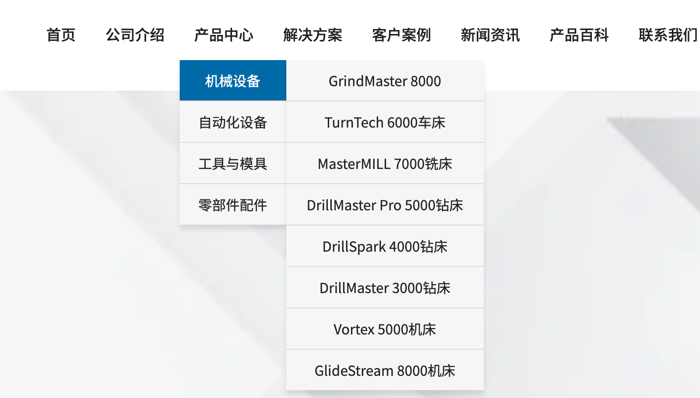
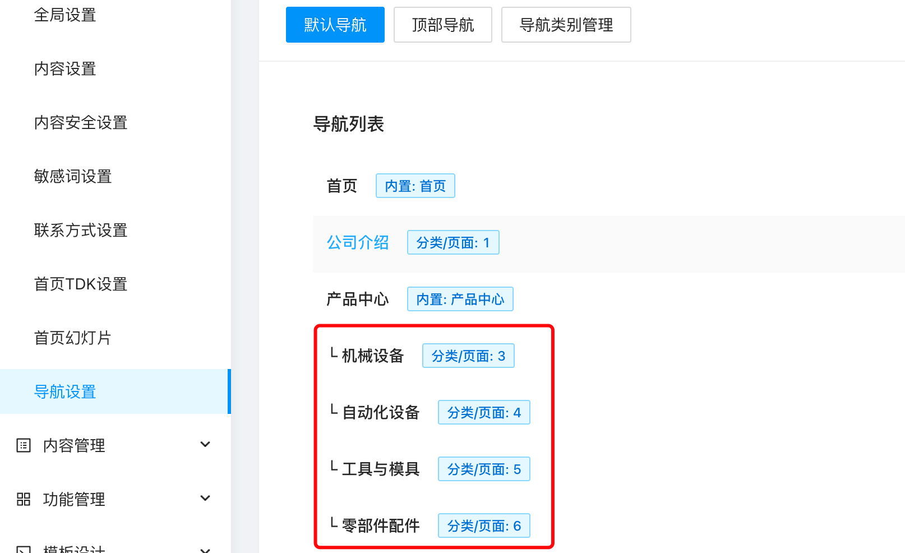
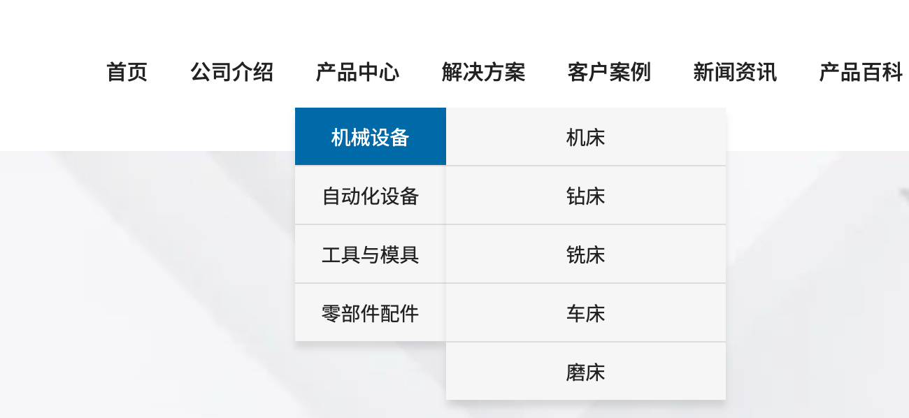

# 导航列表标签

说明：用于获取页面导航列表

使用方法： `` 如将变量定义为 navs `...`，也可以定义为其他变量名称，定义后，需要与下面的 for 循环使用的变量名称一致。

### navList 支持的参数有

- 导航列表 ID `typeId`  
  `typeId` 为后台的导航类别 ID，默认 `typeId=1`，如果后台设置了多个导航类别，可以通过`typeId` 来指定调用。
- 站点 ID `siteId`  
  `siteId` 一般不需要填写，如果你使用后台的多站点管理创建了多个站点，并且想调用其他站点的数据，则可以通过指定 `siteId` 来实现调用指定站点的数据。

navList 需要使用使用 endnavList 标签表示结束，中间使用 for 循环输出内容。

navs 是一个数组对象，因此需要使用 `for` 循环来输出

### item 为 for 循环体内的变量，可用的字段有：

- 导航标题 `Title`
- 子标题 `SubTitle`
- 导航描述 `Description`
- 导航链接 `Link`
- 对应分类 ID `PageId` 如果这个导航菜单是选择了分类的话，则存在
- 是否当前链接 `IsCurrent`
- 下级导航列表 `NavList` 下级导航内同样具有 item 相同的字段。

### 代码示例

```twig

<ul>
    
        <li class="active">
            <a href="{{ item.Link }}">{{item.Title}}</a>
            
            <dl>
                
                    <dd class="active">
                        <a href="{{ inner.Link }}">{{inner.Title}}</a>
                    </dd>
                
            </dl>
            
        </li>
    
</ul>

```

### 常见使用实例

1. 在导航上显示下拉分类，并且在分类下显示产品文档。如图：




调用代码示例，该调用需要在后台已经设置好二级导航的基础上（代码不包含 css 样式控制）

```twig
<ul>
    
    
    <li>
        <a href="{{ item.Link }}">{{item.Title}}</a>
        
        <ul class="nav-menu-child">
            
            <li>
                <a href="{{ inner.Link }}">{{inner.Title}}</a>
                
                
                <ul class="nav-menu-child-child">
                    
                    <li><a href="{{item.Link}}">{{item.Title}}</a></li>
                    
                </ul>
                
                
            </li>
            
        </ul>
        
    </li>
    
    
</ul>
```

2. 在导航上显示下拉分类，并且在分类下显示它的下级分类，如果没有则不显示。如图：



调用代码示例，该调用需要在后台已经设置好二级导航的基础上（代码不包含 css 样式控制）

```twig
<ul>
    
    
    <li>
        <a href="{{ item.Link }}">{{item.Title}}</a>
        
        <ul class="nav-menu-child">
            
            <li>
                <a href="{{ inner.Link }}">{{inner.Title}}</a>
                
                    
                    
                    <ul>
                        
                        <li>
                            <a href="{{ item.Link }}">{{item.Title}}</a>
                        </li>
                        
                    </ul>
                    
                    
                
            </li>
            
        </ul>
        
    </li>
    
    
</ul>
```
